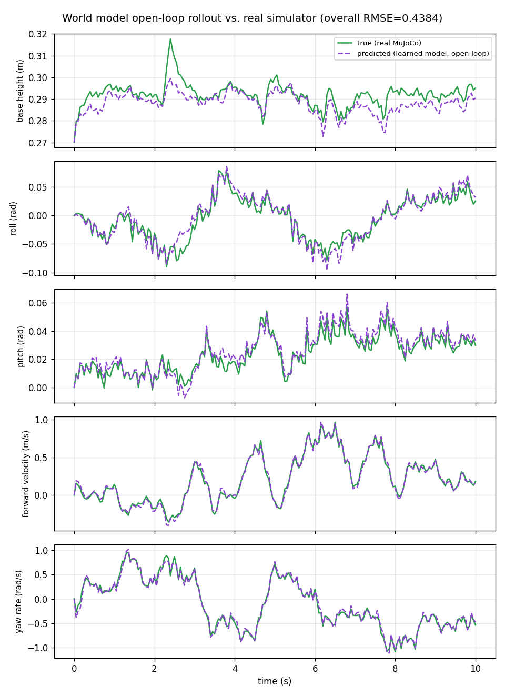
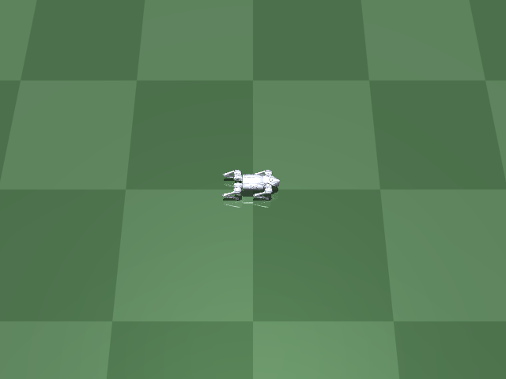
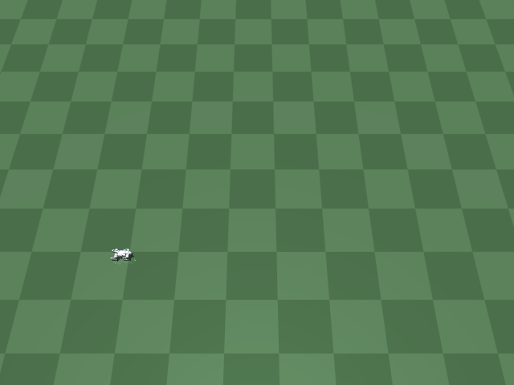
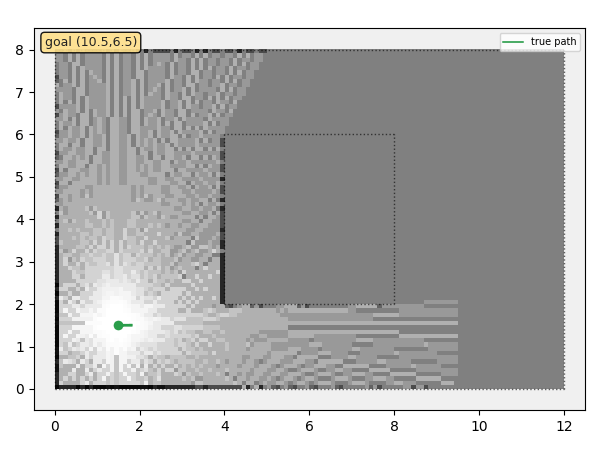
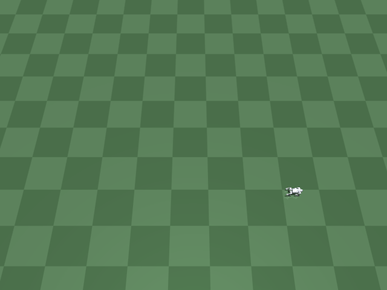
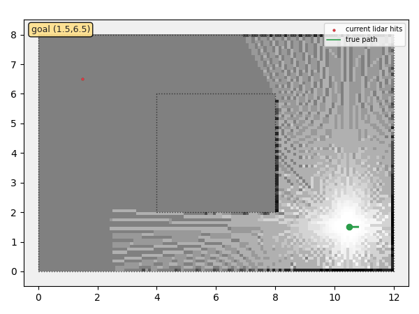
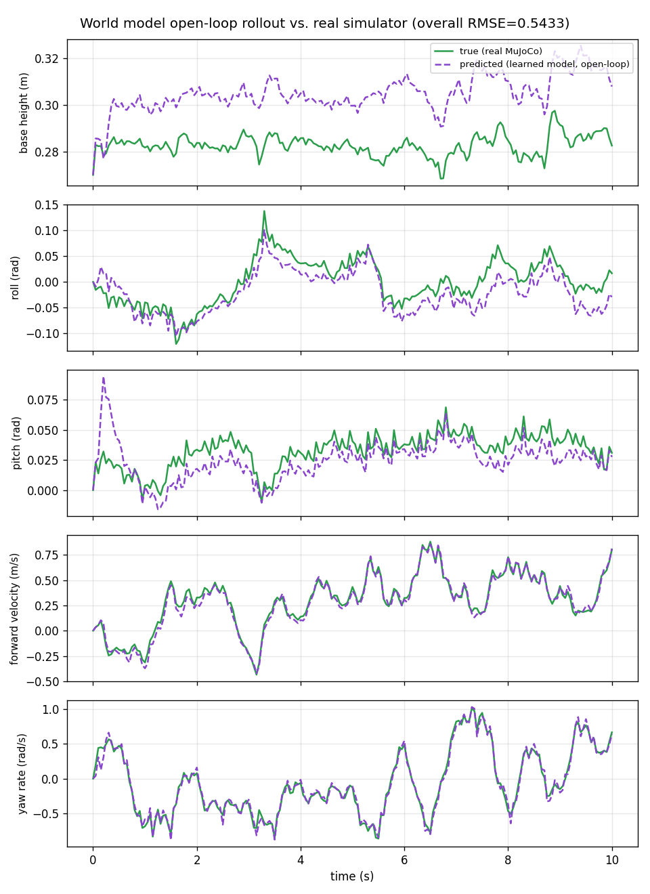
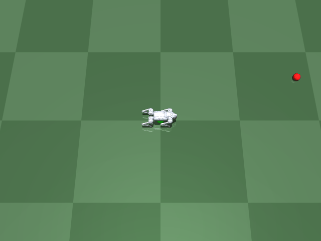
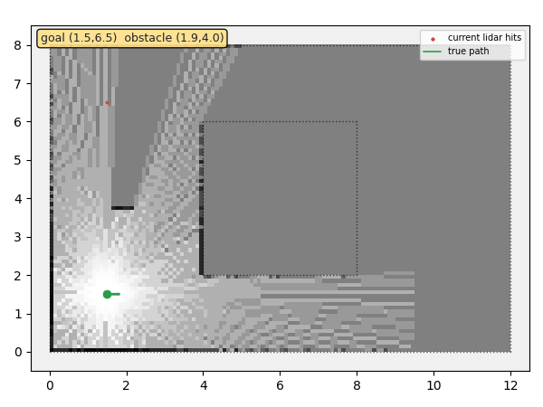

# World Action Model (WAM)

A learned forward-dynamics "world model" for the Unitree Go2 quadruped: given the robot's
current state and a commanded action, predict what state comes next -- without running the
real physics simulator. Trained entirely on rollout data collected from the sibling
`go1_rl_walk` project's own MuJoCo Go2 + classical convex-MPC controller.

A separate project (and repo) from `go1_rl_walk` and `slam_sim` (sibling directories),
following the same convention: each new kind of problem gets its own repo, not a branch of
an existing one.

## Scoping decisions

- **Data source: reuse the real Go2 quadruped, not a toy environment.** `go1_rl_walk/mpc`'s
  `MPCResidualEnv` (real MuJoCo rigid-body dynamics + classical convex-MPC balance/footstep
  control) is already a working, verified simulator -- generating rollouts from it means the
  world model learns real quadruped dynamics (stance-phase impacts, balance recovery, slip)
  from the start, not an idealized toy. Zero files in `go1_rl_walk` are modified; this
  project only ever imports from it, the same convention `slam_sim`'s Stage 6+ established.
- **Action = the velocity command, not the 12-dim residual torque.** `MPCResidualEnv` has
  two control levers: `env.step(residual_action)` (a 12-dim per-tick torque correction on
  top of the MPC) and `env.set_command(speed, lateral, yaw_rate)` (the 3-dim target
  velocity the MPC steers toward). Every demo across `go1_rl_walk` and `slam_sim` that
  reached a final, adopted state used `residual_action = 0` (pure classical MPC, no RL
  correction) -- so the 3-dim velocity command is the control lever actually in use, and
  the natural "action" for a world model meant to eventually support planning/navigation
  (Stage 2's goal) the same way `go1_rl_walk/mpc/navigate_mpc.py` already does by hand.
- **State = a reduced physical state, not the full 47-dim RL observation.** `MPCResidualEnv`'s
  own observation already bundles `[v_body(3), w_body(3), roll, pitch, qpos(12), qvel(12),
  mpc_tau(12), cmd(3)]` (47 dims) -- this project predicts everything except `mpc_tau` (an
  internal control signal, not "world state") and `cmd` (that's the action, not something to
  predict), plus `base_height` (tracked separately in `info`, not in `obs`). 33 dims total:
  `[v_body(3), w_body(3), roll, pitch, base_height, qpos(12), qvel(12)]`.
- **Predict state DELTAS at a 50ms macro-step, not raw next-state at the 5ms physics tick.**
  `MPCResidualEnv` runs its control loop at 200Hz (5ms/tick) -- predicting a single tick's
  change is almost an identity function (not a meaningfully hard or demonstrable learning
  problem) and too fine-grained for a future planner to reason about. Every 10 physics
  ticks (50ms), with the velocity command held constant across them, is recorded as one
  world-model transition `(state_t, action, state_{t+1})` -- a timescale closer to what
  `go1_rl_walk`'s own navigation loop already re-plans at.
- **Low-dimensional state prediction first, not pixels or a learned latent space.** The
  simplest version of this problem (direct state-to-state regression, a small MLP) gets
  built and verified before anything more ambitious -- same staged discipline as
  `slam_sim`'s own kinematic-robot-first choice.
- **Stage 1 = prediction only; Stage 2 = use it for planning.** Verify the learned model's
  open-loop rollouts actually track the real simulator's before building anything on top of
  it. Only once that's trustworthy does it make sense to use the model for something (e.g.
  a learned-model MPC/planner, replacing or augmenting `navigate_mpc.py`'s hand-designed
  steering law) -- a user-requested two-part plan ("do 1 then 2"), not a speculative
  extension tacked on early.

## Staged plan

1. **Data collection + a simple MLP dynamics model, verified by open-loop rollout
   comparison against the real simulator** -- DONE.
2. **Use the learned model for planning/control** -- DONE.
3. **Obstacle-aware planning, reusing `slam_sim`'s lidar + occupancy map** -- DONE, including
   a follow-on fix (Stage 3b: A* global waypoints) for the corner-stall limitation found
   during Stage 3 itself.
4. **Extend to uneven terrain** -- DONE (partial/honest result, see below).
5. **Combine obstacle-aware planning with uneven terrain** -- DONE (found and fixed a real
   teleport/terrain-height bug along the way; honest bounded result, see below).
6. **A history-conditioned, action-chunked world model** -- DONE (clear rollout-accuracy
   win once scaled up; no downstream navigation win, and slower planning; see below).
7. **Tackle the planner's dead-reckoning error directly** -- DONE (two well-measured,
   negative/harmful results; investigation closed, see below).
8. **A moving obstacle** -- DONE (needed retuning for reaction speed, not cost weights;
   real load-bearing result once tuned, see below).
9. **Velocity-extrapolated obstacle prediction** -- DONE (first attempt regressed safety;
   diagnosed and fixed a footprint-radius gap, then a real if narrow improvement; see below).

### Stage 1: data collection, training, and open-loop verification

`collect_data.py` ran 50 training + 10 validation episodes (10s each, real Go2 + classical
MPC, random held-then-ramped velocity commands -- see "Scoping decisions"), yielding 9,806
training / 1,855 validation transitions (a handful of episodes fell short of the full 200
transitions/episode: rarer falls even with the ramped commands, discarded rather than kept
as contaminated data).

**First attempt (one-step loss only) failed open-loop, in an instructive way.** Training
`wam/model.py`'s MLP purely on one-step `(state, action) -> next_state` prediction looked
great by the metric it was trained on (val one-step MAE 0.16), but `eval_rollout.py`'s real
test -- feed the model's own predictions back in autoregressively for a full 10s, 200-step
held-out episode, no peeking at ground truth -- told a different story: it tracked the real
simulator closely for about 8 seconds, then **blew up exponentially** (roll reaching 6 rad,
base height "climbing" past 2m by t=10s). Overall rollout RMSE: 8.71. This is the classic
compounding-error failure mode of autoregressive models trained only on one-step loss, not
a bug in the data or the env -- confirmed by the plot showing a clean, accurate trajectory
for most of the episode before the error visibly starts compounding near t=8s.

**Fix: train with an H-step rollout loss, not just one-step.** `train_world_model.py` now
trains on a COMBINATION of the one-step loss (cheap, stable gradient) and a 20-step
(1.0s) autoregressive rollout loss -- unrolling the model itself during training and
penalizing the full trajectory's error, not just a single step's, the same approach
model-based RL methods (PETS, MBPO, Dreamer) use for exactly this reason. Result: overall
rollout RMSE dropped from 8.71 to **0.44** (20x), with every plotted quantity (base height,
roll, pitch, forward velocity, yaw rate) tracking the real simulator closely across the
*entire* 10-second, 200-step held-out episode -- no blowup. The model catches one real
transient (a ~0.03m base-height bounce around t=2.3s) a bit late but recovers and keeps
tracking afterward.

<p align="center">
  
</p>

Needs `go1_rl_walk/mpc`'s own venv (`mujoco`, `torch`, `casadi`/`pinocchio` all live there):

```bash
/home/cstu/robo/go1_rl_walk/mpc/venv/bin/python3 collect_data.py \
    --episodes 50 --val-episodes 10 --out data/rollouts.npz
/home/cstu/robo/go1_rl_walk/mpc/venv/bin/python3 train_world_model.py \
    --data data/rollouts.npz --checkpoint checkpoints/world_model.pt
/home/cstu/robo/go1_rl_walk/mpc/venv/bin/python3 eval_rollout.py \
    --checkpoint checkpoints/world_model.pt --record media/rollout_comparison.png
```

### Stage 2: a learned-model CEM planner, replacing the hand-designed steering law

The world model's own 33-dim state has no world-frame `(x, y, yaw)` in it (by design -- see
"Scoping decisions"), so a planner that wants to reason about a world-frame goal has to
dead-reckon pose itself from the state components the model *does* predict: body-frame
forward/lateral velocity and yaw-rate, integrated forward each step (`wam/pose.py`, same
body->world rotation convention `mpc_residual_env.py` itself uses). The planner
(`wam/planner.py`'s `CEMPlanner`) is a standard shooting method: sample many candidate
*constant* velocity commands, roll each one forward through the learned model for a short
horizon (10 macro-steps = 0.5s) while dead-reckoning pose alongside it, score each rollout
by final distance-to-goal + heading alignment + a stability penalty (keeping roll/pitch/
height near the training distribution's own typical standing values, since the model was
never trained on falls and can't be trusted to extrapolate into them), keep the best-scoring
"elite" samples, refit the sampling distribution around them, and repeat for 3 iterations
(cross-entropy method). Candidates are a single constant command across the whole horizon,
not a freely time-varying sequence, deliberately: Stage 1's training data only ever changed
its target command every 0.5s, so a constant-command rollout matches what the model
actually saw during training, where a faster-switching sequence would ask it to extrapolate
beyond its own training distribution.

`navigate_wam.py` drives the real Go2 (same zero-RL-residual, classical-MPC convention as
every other script here) toward a world-frame goal by replanning every 0.25s (5 macro-steps)
with the CEM planner and holding its chosen command in between (rate-limited the same way
`navigate_mpc.py`'s is, for the same QP-stability reason). Every tick still reads the REAL
ground-truth pose from the simulator for "where am I now" -- only the planner's internal
look-ahead rollout uses the learned model and its own dead-reckoned pose estimate to score
candidates.

**Evaluated against `go1_rl_walk/mpc/navigate_mpc.py`'s two hand-designed steering laws**
(`strafe`: the original crab-toward-goal law; `turn`: turn-to-face + drive forward), across
10 randomized (seed, goal) trials -- same seeds/goals for all three methods, goals 1.5-3.0m
away in a random direction, so the same initial state and target set is attempted by all
three. See "go1-eval-method": judged across repeated randomized trials, not a single run.

| method      | success | mean time-to-reach | mean final distance |
|-------------|---------|---------------------|----------------------|
| **wam (CEM planner)** | **10/10** | **3.28 s** | **0.043 m** |
| mpc strafe  | 10/10   | 5.27 s              | 0.136 m              |
| mpc turn    | 10/10   | 4.56 s              | 0.154 m              |

All three reached every one of the 10 goals with zero falls -- the learned-model planner is
just as reliable as the hand-designed laws here, and noticeably faster and more precise:
~30-38% faster to reach, and 3-4x tighter on final distance (closer than the 0.15m arrival
tolerance itself, vs. the analytic laws settling right around it). The gap is plausible, not
just noise: the CEM planner jointly optimizes all 3 command dimensions (speed, lateral,
yaw-rate) against the actual predicted outcome every replan, where `compute_nav_command`/
`compute_nav_command_turn` are decoupled proportional laws recomputed from instantaneous
error alone. Reproduce with:

```bash
/home/cstu/robo/go1_rl_walk/mpc/venv/bin/python3 eval_navigate.py \
    --trials 10 --seconds 15 --base-seed 200 --goal-seed 7
```

<p align="center">
  
</p>

```bash
/home/cstu/robo/go1_rl_walk/mpc/venv/bin/python3 navigate_wam.py \
    --goal-x 3.0 --goal-y 1.0 --checkpoint checkpoints/world_model.pt --record out.gif
```

### Stage 3: obstacle-aware planning, reusing `slam_sim`'s lidar + occupancy map

Everything sensing/mapping-related here is reused COMPLETELY UNMODIFIED from the sibling
`slam_sim` project's own earlier stages, not re-derived: `slam.world.World.loop_corridor()`
(a 12x8m rectangle with a 4x4m island in the middle -- a straight line between opposite
corners is blocked, forcing genuine routing around it), `demo_stage6_go2_world.py`'s
`build_env_xml`/wall-injection for putting that island into the real Go2's MuJoCo scene,
`slam.mj_lidar.mj_lidar_scan`'s real ray-cast lidar, and `slam.occupancy_grid.OccupancyGrid`
for the log-odds map those scans build up over time. This stage only adds the planning
side: `wam/planner.py`'s `CEMPlanner` now accepts an `obstacle_points` argument (the
occupancy grid's currently-known occupied cell centers) and scores every candidate
rollout's predicted (x, y) against the nearest one -- a soft quadratic penalty inside a
0.5m safety margin, plus a large flat penalty if a rollout predicts actually crossing a
0.35m collision margin. Deliberately uses the REAL ground-truth pose (not `slam_sim`'s own
ICP-corrected belief pose) to build the map -- localization-under-drift is a separate,
already-solved problem over in `slam_sim`'s Stage 4/6; this stage's new ground is planning
around what's been sensed, not re-demonstrating localization. One real consequence: the map
only contains what's been scanned so far, so the planner can only avoid what it has already
seen, same as any real lidar-then-plan stack.

**Confirmed the obstacle cost is actually necessary, not just harmless:** with it disabled
(`--disable-obstacle-cost`, Stage 2's planner unchanged), the robot drives straight at the
island and falls/QP-fails almost immediately (final distance 7.6-7.8m from a ~10.3m start).
With it enabled, the same goal is reached safely, routing around the island:

<p align="center">
  
  
</p>
<p align="center">
  
</p>

**Evaluated across 4 start/goal pairs in the same world** (one with no obstacle in the way,
as a sanity check the planner doesn't detour needlessly; three forcing a real detour around
different sides/corners of the island):

| start &rarr; goal | obstacle in the way? | result |
|---|---|---|
| (1.5,1.5) &rarr; (1.5,6.5) | no (clear corridor) | reached in 5.9s -- no needless detour |
| (1.5,1.5) &rarr; (10.5,6.5) | yes | reached in 30.5-31.6s (reproduced twice) |
| (10.5,1.5) &rarr; (1.5,6.5) | yes | safe, but did not finish in 45s (final distance 2.96m) |
| (1.5,6.5) &rarr; (10.5,1.5) | yes | safe, but did not finish in 45s (final distance 7.02m) |

Zero falls across all 4 trials, including the two that didn't finish -- the obstacle cost's
core safety claim held in every case. But it's not a uniformly efficient router: the two
unfinished trials both stall near a sharp convex corner of the island, creeping at a few
cm/s rather than committing to a decisive turn around it (one of these, given more time,
eventually broke free and finished at 31.3s -- not stuck forever, just slow and
inconsistent). This is a real, explainable limitation of this specific design, not a bug:
the obstacle cost only ever looks at where the planner's own SHORT (0.5s), DEAD-RECKONED
rollout predicts the robot will be -- near a sharp corner, small pose-integration error
inside that short horizon can make a genuinely-clear turn look like it still clips the
safety margin, so the CEM settles for a locally-safe near-zero-progress crawl instead.

```bash
/home/cstu/robo/go1_rl_walk/mpc/venv/bin/python3 navigate_wam_obstacles.py \
    --goal-x 10.5 --goal-y 6.5 --checkpoint checkpoints/world_model.pt \
    --record-robot media/robot.gif --record-map media/map.gif
```

#### Stage 3b: A* global waypoints fix the corner-stall

`wam/global_planner.py` adds exactly the fix flagged above: A* over the SAME occupancy grid
(obstacle cells inflated by the robot's own collision margin), simplified by greedy
line-of-sight "string-pulling" down to a handful of long, direct legs. Recomputed from
scratch every CEM replan (receding-horizon, no waypoint-index state to carry across ticks --
cheap on a map this size, ~10k cells). The CEM is then handed the nearest waypoint still in
line-of-sight of the robot's current position as its goal, instead of the raw (possibly
far-away, behind-a-corner) true goal -- so it only ever has to solve the easy local problem
of walking a mostly-straight line, never "route around this obstacle" from scratch under a
0.5s dead-reckoned horizon.

<p align="center">
  
  
</p>

**Multi-seed before/after on the same 4 start/goal pairs** (3 seeds each, `eval_obstacles.py`):

| start &rarr; goal | A* disabled (Stage 3 original) | A* enabled (Stage 3b) |
|---|---|---|
| no obstacle (sanity check) | reached in 5.9-6.0s (all 3 seeds) | reached in 5.9-6.0s (all 3 seeds, unchanged) |
| detour A | reached in 29.7-31.4s | reached in **14.3-14.4s** |
| detour B (corner-stall case) | 2/3 seeds timed out (d=1.68-7.06m); 1 reached @39.9s | reached in **17.4-17.5s, all 3 seeds** |
| detour C (corner-stall case) | 2/3 seeds timed out (d=7.04-7.07m); 1 reached @40.5s | reached in **13.6-14.3s, all 3 seeds** |

12/12 trials reach the goal with A* enabled (up from 4/12 without it), roughly 2x faster
even on the detour that didn't stall before, and the no-obstacle sanity check is completely
unchanged -- confirming A* isn't adding needless detours where none are required. Zero falls
in any trial, either condition. Reproduce with:

```bash
/home/cstu/robo/go1_rl_walk/mpc/venv/bin/python3 eval_obstacles.py \
    --seeds 3 --base-seed 100 --seconds 45
```

### Stage 4: extend to uneven terrain -- a genuine but partial result

`MPCResidualEnv`'s own `terrain_amplitude_range` constructor argument already resamples a
fresh random bump amplitude at every `reset()` (same mechanism it uses for
speed/lateral/yaw-rate ranges) -- so `collect_data.py` and `eval_rollout.py` both gained a
`--terrain-amplitude-max` flag that just threads a `(0.0, max)` range through, no new
terrain-generation code needed.

**Confirmed the generalization gap first, not assumed it:** Stage 1's flat-only checkpoint's
open-loop rollout RMSE on terrain (0.08m bumps) is meaningfully worse than on flat ground --
across 6 held-out seeds, mean RMSE 0.62 (flat) vs. **1.33** (terrain), driven mostly by leg
joint-velocity error (qvel RMSE up to ~1.5-2x worse per-joint on terrain). Expected: terrain
disturbances are an exogenous input the model never saw, not something the (state, action)
pair alone can anticipate.

**Collected a terrain-inclusive dataset and retrained** (`collect_data.py --terrain-amplitude-
max 0.08`, 50 train + 10 val 10s episodes, 9708/1928 transitions -- comparable size to Stage
1's flat dataset). The first training run surfaced a real instability: `one_step_loss` and
`rollout_train_loss` both suddenly spiked ~8x around epoch 100 (one outlier batch through the
H-step rollout loss's repeated model composition producing an unusually large gradient --
not seen on flat data, where the gradient magnitudes stay smaller throughout) and only
partially recovered by epoch 199. **Fixed with gradient-norm clipping** (`--grad-clip 1.0`,
now on by default in `train_world_model.py`) -- the retrained run's loss curve was smooth
throughout, with a better best checkpoint (val rollout MAE 0.297 vs. 0.340 without clipping).

**Evaluated across 6 held-out seeds per condition** (`eval_terrain.py`), not a single
episode -- a single episode's RMSE was actually MISLEADING here: the first terrain-trained
checkpoint happened to score *better* than the flat checkpoint on one specific held-out
episode and *worse* on another, which would have supported opposite conclusions depending
on which seed got tested. See [[go1-review-before-trusting]].

| condition | mean RMSE | std |
|---|---|---|
| flat-trained model, flat ground | 0.62 | 0.23 |
| flat-trained model, terrain | 1.33 | 0.73 |
| terrain-trained model, flat ground | 0.86 | 0.35 |
| terrain-trained model, terrain | 1.03 | 0.43 |

**Honest conclusion: a real but partial improvement, not a clean fix like Stages 1-3.**
Training on terrain data measurably helps on terrain (mean RMSE down ~22%, std down ~40% --
fewer of the occasional much-worse episodes the flat model produced on terrain) but doesn't
fully close the gap back to flat-ground-level accuracy, and costs a real regression on flat
ground itself (0.62 -> 0.86). This is the ordinary cost of broadening a training
distribution to cover a harder case, not a bug -- the same trade-off `go1_rl_walk`'s own
flat-vs-random-terrain RL staging ran into (see [[go1-staged-plan]]).

**At the downstream navigation level, this difference didn't clearly show up.** Ran
`navigate_wam.py` with `--terrain-amplitude 0.08` across the same 5 (seed, goal) pairs for
both checkpoints: both reached 4/5 goals with similar times and final distances, and both
fell on the SAME seed (200) -- suggesting that particular terrain realization was just hard
for the real classical-MPC controller regardless of which learned model informed planning,
not a world-model-accuracy effect. The modest rollout-accuracy edge the terrain-trained
model has didn't translate into a visibly better navigation success rate at this sample
size -- a genuinely inconclusive result at the planning level, reported as such rather than
rounded up to a win.

```bash
/home/cstu/robo/go1_rl_walk/mpc/venv/bin/python3 collect_data.py \
    --terrain-amplitude-max 0.08 --episodes 50 --val-episodes 10 --out data/rollouts_terrain.npz
/home/cstu/robo/go1_rl_walk/mpc/venv/bin/python3 train_world_model.py \
    --data data/rollouts_terrain.npz --checkpoint checkpoints/world_model_terrain.pt
/home/cstu/robo/go1_rl_walk/mpc/venv/bin/python3 eval_terrain.py --trials 6
```

<p align="center">
  
</p>

### Stage 5: obstacle-aware planning on uneven terrain -- combining Stage 3b + Stage 4

Neither prior stage tested this combination: Stage 3/3b's island world was flat ground, and
Stage 4's downstream navigation check used the open, obstacle-free default world. `navigate_
wam_obstacles.py` gained the same `--terrain-amplitude-max` passthrough as `collect_data.py`/
`eval_rollout.py`, so the same island-plus-walls world used for obstacle avoidance can also
have Stage 4's 0.08m random bumps.

**Found and fixed a real bug this surfaced, not a planning/dynamics result:** the script
teleports the robot to `--start-x/-y` after `env.reset()` by directly overwriting `qpos[0:2]`
-- on flat ground this is harmless (ground height is 0 everywhere), but with terrain enabled
it left `qpos[2]` (base height) set for the DEFAULT spawn point's terrain height, not the new
start point's. Every affected trial fell within ~0.1-0.2m of start (confirmed: final distance
after "falling" was ~4.8-4.9m out of a ~5.0m straight-line start-to-goal distance -- the
robot barely moved before an instant, violent contact from spawning embedded in or floating
above a terrain bump). **Fixed** by reading the terrain height at both the pre- and
post-teleport position and shifting `qpos[2]` by the difference -- a no-op when terrain is
disabled (both heights are 0), so Stage 3/3b's own flat-ground behavior is unaffected.

**With that fixed, ran the real multi-seed comparison** (same 4 start/goal pairs, 3 seeds,
both world-model checkpoints, terrain amplitude 0.08 -- `eval_obstacles_terrain.py`):

| condition | trials reached |
|---|---|
| flat-trained model, obstacles + terrain | 5/12 |
| terrain-trained model, obstacles + terrain | 3/12 |

A much higher fall rate than either capability alone (Stage 3b: 12/12 on flat ground; Stage
4's downstream check: 4/5 on open terrain with no obstacles) -- obstacle avoidance's sharper
turns near walls, combined with real ground disturbance, is a genuinely harder combination.
Notably, the SAME seeds fell for both checkpoints at similar final distances -- pointing away
from "the world model's predictive accuracy is the bottleneck" (which checkpoint is loaded
barely matters) and toward the classical MPC's footstep planner, which by default assumes
flat touchdown height regardless of terrain (same naive-footstep design `go1_rl_walk`'s own
Stage 11 terrain work already identified and built a fix for).

**Reused that existing fix, unmodified**: `MPCResidualEnv`'s own `terrain_footstep_planning`
flag (already implemented and validated in `go1_rl_walk`, just not previously threaded
through this script) makes the footstep planner terrain-aware instead of assuming flat
ground. Re-ran the same comparison with it enabled:

| condition | trials reached |
|---|---|
| flat-trained model, obstacles + terrain, footstep-planning ON | 6/12 |
| terrain-trained model, obstacles + terrain, footstep-planning ON | 6/12 |

A real, replicable improvement (5/12 and 3/12 &rarr; 6/12 both) -- but not a full fix: one
terrain draw (seed 301) fails on every single start/goal pair for both checkpoints even with
footstep-aware planning, matching `go1_rl_walk/mpc`'s own documented finding that terrain-
aware footstep planning alone still leaves a substantial QP-failure rate on hard terrain.
Zero timeouts across all 48 trials in this stage (every result was either "reached" or
"fell") -- Stage 3b's corner-stall fix holds even here; the remaining failures are
terrain-induced falls, a different and lower-level problem than path planning.

**Honest conclusion**: obstacle-aware planning and terrain generalization each work well on
their own, but stacking them is a genuinely harder problem that neither this project's
learned world model nor its CEM/A* planner can fix alone -- the bottleneck is the classical
MPC's terrain-robustness, a `go1_rl_walk`-level limitation (already partially addressed
there, not fully solved) rather than something to chase further inside `wam`'s own scope.
Reporting this plainly rather than cherry-picking the footstep-planning-on numbers as a win.

```bash
/home/cstu/robo/go1_rl_walk/mpc/venv/bin/python3 eval_obstacles_terrain.py \
    --seeds 3 --base-seed 300 --terrain-amplitude-max 0.08 --seconds 45 \
    --terrain-footstep-planning
```

### Stage 6: a history-conditioned, action-chunked world model -- better predictions, no downstream win

User asked to try ideas from Physical Intelligence-style "action chunking" architectures
(pi0 and similar -- policy models, not dynamics models, but the same two ideas apply to a
dynamics model): (1) condition on a short HISTORY of past (state, action) pairs, not just
the instantaneous state, and (2) predict a whole CHUNK of future states jointly from a
chunk of future actions in ONE non-autoregressive forward pass, instead of calling a
single-step model repeatedly and feeding its own prediction back in.

`wam/chunked_model.py`'s `ChunkedWorldModel`: a small causal transformer over a token
sequence `[history_len past (state,action) pairs] + [current state, pivot] + [chunk_len
future actions]`. Each future position predicts its delta relative to the CHUNK'S OWN
START state (not the previous step -- the model never sees intermediate steps within one
forward pass, that's the actual point of non-autoregressive prediction). Trained on the
exact same data `collect_data.py` already produces (`train_chunked_world_model.py`), just
windowed differently -- no new data collection needed.

**First architecture (d_model=128, 2 layers) was only comparable to the existing MLP, not
better** -- 6 paired held-out seeds: chunked mean RMSE 0.594 vs. MLP's 0.560, 5 of 6 seeds
favoring the MLP. **Scaled up (d_model=256, 3 layers, more training epochs) and the result
flipped cleanly**: mean RMSE 0.441 vs. 0.560, **6 of 6 seeds** favoring the chunked model
(`eval_rollout_chunked.py`) -- a real, consistent ~21% improvement, not noise. The smaller
architecture was genuinely under-capacity, not evidence the underlying idea doesn't work.

```bash
/home/cstu/robo/go1_rl_walk/mpc/venv/bin/python3 train_chunked_world_model.py \
    --data data/rollouts.npz --checkpoint checkpoints/world_model_chunked_large.pt \
    --d-model 256 --n-heads 8 --n-layers 3 --d-ff 512 --epochs 300
/home/cstu/robo/go1_rl_walk/mpc/venv/bin/python3 eval_rollout_chunked.py \
    --chunked-checkpoint checkpoints/world_model_chunked_large.pt --seeds 6
```

**Built the planner integration anyway** (`wam/chunked_planner.py`'s `ChunkedCEMPlanner` +
`ChunkedHistoryBuffer`, `navigate_wam_chunked.py`) to see whether the clear accuracy win
translated downstream. It didn't, in either direction that matters:

| method | success | mean time-to-goal | mean final distance | mean `plan()` wall-clock |
|---|---|---|---|---|
| `navigate_wam.py` (single-step MLP) | 10/10 | 3.29s | 0.046m | 12ms |
| `navigate_wam_chunked.py` (chunked) | 10/10 | 3.30s | 0.064m | 164ms |

Same 10 seeds/goals as Stage 2's own comparison. Success and time-to-goal are
essentially identical; final-distance precision is slightly worse for the chunked
planner (still well inside the 0.15m arrival tolerance, not a meaningful difference in
practice); and the chunked planner's `plan()` call is **~13x slower** despite needing
only 1 batched model call per horizon instead of 10 -- the transformer's per-call cost
dominates over the savings from fewer calls, at least at this model size and `n_samples`.

<p align="center">
  
</p>

```bash
/home/cstu/robo/go1_rl_walk/mpc/venv/bin/python3 navigate_wam_chunked.py \
    --goal-x 3.0 --goal-y 1.0 --seed 200 \
    --checkpoint checkpoints/world_model_chunked_large.pt --record media/navigate_wam_chunked_robot.gif
```

**Honest conclusion**: a genuinely better predictive model (clearly verified, 6/6 seeds)
did not produce a better planner, and cost real planning speed -- the same "model
accuracy isn't the bottleneck" lesson Stage 4/5 already found with the terrain-trained
checkpoint, now showing up again with a structurally different model. Kept as working,
verified infrastructure (not deleted), not adopted as the default checkpoint/planner.

```bash
/home/cstu/robo/go1_rl_walk/mpc/venv/bin/python3 navigate_wam_chunked.py \
    --goal-x 3.0 --goal-y 1.0 --checkpoint checkpoints/world_model_chunked_large.pt
```

### Stage 7: tackled the planner's dead-reckoning error directly -- two negative results, closed

`wam/pose.py`'s `integrate_pose` is only ever evaluated inside a CEM rollout, 10 macro-steps
(0.5s) deep per candidate, using the model's own autoregressively-predicted velocities --
Stage 3's corner-stall writeup flagged "small pose-integration error" as a plausible
contributor to the planner's limitations without ever isolating it. User asked to tackle this
directly rather than keep treating it as a vague caveat.

**Experiment 1 -- is the Euler integration SCHEME itself the problem?** Added
`integrate_pose_exact`, a closed-form unicycle-arc integration (accounts for yaw continuously
rotating across the 50ms step, instead of freezing it at the step's start like forward-Euler
does) and built `eval_pose_integration.py`: using 200 real held-out hold-blocks (6 seeds) --
each one a natural, already-labeled instance of exactly what the planner tries to predict
(0.5s under one constant command) -- it compares four horizon-matched final-position
estimates against real ground truth:

| estimate | mean error |
|---|---|
| integration-only, Euler, given REAL velocities | 0.0141m |
| integration-only, exact-arc, given REAL velocities | 0.0140m |
| full rollout (model-predicted velocities), Euler [current] | 0.1178m |
| full rollout (model-predicted velocities), exact-arc | 0.1180m |

**Finding: the integration scheme contributes almost nothing** (0.014m either way, a 1mm
difference -- noise). The real error, ~8x larger, is the world model's own compounding
autoregressive prediction error over the 10-step rollout; swapping in exact-arc integration
doesn't help there either (95/200 blocks better, 105/200 worse, mean delta -0.0002m). Ruled
out cleanly, not assumed.

```bash
/home/cstu/robo/go1_rl_walk/mpc/venv/bin/python3 eval_pose_integration.py \
    --checkpoint checkpoints/world_model.pt --seeds 6
```

**Experiment 2 -- does shortening the horizon (less model-compounding error per rollout)
help downstream?** `navigate_wam.py` already exposes `--horizon-steps` (default 10 = 0.5s)
independently of `--replan-every` (5 macro-steps = 0.25s) -- the CEM commits to a full 0.5s
of imagined rollout even though only half that time elapses before the next real-state
correction. Shortening `horizon_steps` to 5 (matching the replan cadence exactly) should, by
Experiment 1's own measurement, roughly halve the model-compounding error each rollout
accumulates. Tested on the same 10-seed/goal protocol Stage 2/6 already use:

| horizon_steps | success | mean time-to-reach | mean final distance |
|---|---|---|---|
| 10 (current default) | 10/10 | 3.29s | 0.049m |
| 5 (matches replan cadence) | **9/10 (1 fall)** | 3.38s | **0.175m** |

**It backfired.** Shortening the horizon made things measurably worse, not better -- one
real fall (none before), final-distance precision nearly 4x worse, time-to-goal essentially
unchanged. Most likely explanation: CEM needs enough lookahead for a candidate command's
effect (through inertia/turning) to meaningfully separate it from its neighbors in the
sampling distribution -- a shorter horizon starves the cost function of that separation, so
it starts ranking candidates on noise rather than real differences, even though each
individual rollout's own absolute position estimate is less eroded by compounding error.

```bash
/home/cstu/robo/go1_rl_walk/mpc/venv/bin/python3 eval_navigate.py \
    --trials 10 --seconds 15 --base-seed 200 --goal-seed 7 --methods wam --horizon-steps 5
```

**Honest conclusion, investigation closed**: two concrete, well-measured attempts at
"dead-reckoning error" as a fixable planner-mechanics issue came back negative -- one inert
(integration formula), one actively harmful (shorter horizon). This is the same recurring
theme as Stage 4/5/6: the planner's absolute internal position error isn't actually what
limits downstream performance -- what matters more is the CEM having enough lookahead to
rank candidates well. Treating this track as closed (same precedent as `go1_rl_walk`'s
terrain-MPC investigation) rather than trying a third variant without a genuinely new idea.
Kept `integrate_pose_exact` and `eval_pose_integration.py` as working, verified diagnostic
infrastructure (not deleted); `horizon_steps`/`--horizon-steps` stay at their original
default of 10.

### Stage 8: a MOVING obstacle -- the sense-then-plan pipeline handles it, if tuned to react

Every obstacle through Stage 3/3b/5 was static. This stage adds exactly one obstacle that
moves, to stress-test the lidar -> occupancy-grid -> A*/CEM-obstacle-cost pipeline against
something that isn't where the last scan saw it -- a genuinely different regime than "map it
once, then plan around a fixed map."

**Moving it at all needed a MuJoCo mechanism check first.** A plain `<geom>` under
`<worldbody>` (what every static wall/island geom already is, via
`demo_stage6_go2_world.py`'s `inject_walls`) is permanently welded to the world at compile
time -- nothing can move it afterward. `wam/moving_obstacle.py`'s `MovingObstacle` instead
injects a MuJoCo **mocap body** (no joint/inertia; its pose is written directly into
`data.mocap_pos` every tick, not simulated), oscillating sinusoidally along one axis.
Confirmed directly (not assumed) that `slam.mj_lidar.mj_lidar_scan`'s `mj_ray` call reads
live geom transforms on every call (so the lidar sees the moved obstacle with zero changes
needed there) and that `slam.occupancy_grid.OccupancyGrid.update` already does log-odds
free-space clearing along each beam (so a cell the obstacle has moved away from decays back
toward "free" over a few scans, rather than leaving a permanent ghost trail) -- both reused
completely unmodified, same convention every earlier stage follows for `slam_sim` code.

**Default scenario**: reuses `eval_obstacles.py`'s own "no obstacle (sanity check)" pair --
(1.5, 1.5) &rarr; (1.5, 6.5), a straight line through open space with nothing static in the
way -- and adds one obstacle centered on that line's midpoint, sweeping back and forth across
it. What was a trivial, obstacle-free sanity check becomes a genuine dynamic-avoidance test:
the line is clear most of the time, periodically blocked.

<p align="center">
  
  
</p>

**First attempt at default settings (0.8m amplitude, 6s period, Stage 3's 0.25s replan
cadence) was unsafe**: across 7 phase offsets, 3 ended in a real physical fall (the obstacle
has real collision geometry, same `contype`/`conaffinity` as the walls -- a "fall" here means
an actual collision, not just a bad cost). **Tuned three things, not the obstacle cost
weights**: slowed the sweep (6s -> 10s period), replanned more often (`--replan-every` 5 ->
2 macro-steps -- the replan CADENCE, not the rollout horizon Stage 7 already found shouldn't
be shortened), and widened the safety margin slightly (0.5m -> 0.6m). Result: 7/7 across the
same phases, all comfortably clear (worst-case min-distance 0.64m).

**Multi-seed/phase verification that the obstacle cost is actually load-bearing against a
moving obstacle, not just a static one** (8 phases spanning a full sweep cycle,
`eval_moving_obstacle.py`):

| condition | success | fell | mean min-distance to obstacle | worst-case min-distance |
|---|---|---|---|---|
| obstacle cost disabled (Stage 2 goal-only) | 4/8 | 4 | 0.74m | 0.49m |
| obstacle cost enabled (Stage 8) | **8/8** | **0** | 0.82m | 0.60m |

```bash
/home/cstu/robo/go1_rl_walk/mpc/venv/bin/python3 eval_moving_obstacle.py \
    --trials 8 --seconds 25 --base-seed 300
```

**Honest conclusion**: the same sense-then-plan pipeline built for a static island generalizes
to a moving obstacle, but only once retuned for reaction speed (faster replanning) rather than
made more cautious in the cost function alone -- the planner has no model of the obstacle's
own motion, it only ever reacts to where lidar last sensed it, so closing the sensing loop
faster mattered more than penalizing proximity harder. A real, load-bearing result (4/8 ->
8/8, with safer margins too), not a trivial extension.

### Stage 9: velocity-extrapolated obstacle prediction -- a real (if narrow) improvement, after fixing a self-inflicted regression

Stage 8's planner treats the moving obstacle as frozen at its last-sensed position for the
whole 0.5s rollout horizon -- a known, documented limitation. This stage gives the CEM
rollout a predicted FUTURE obstacle position instead, extrapolated from an estimated
velocity, re-evaluated at each rollout step's own future time rather than staying fixed.

**Still obeys the sense-then-plan rule**: `wam/obstacle_tracker.py`'s `DynamicObstacleTracker`
only ever looks at `OccupancyGrid.occupied_points()` -- it never imports or reads
`MovingObstacle`'s ground-truth position or its analytic motion model. The one new prior it
uses is a STATIC-only reference occupancy grid, built once at startup by lidar-scanning the
environment's known wall/island geometry from a grid of vantage points with no obstacle
present -- a reasonable "given a floor plan" assumption, not the same thing as knowing the
obstacle's own position or motion. Any live occupied point far enough from that static
reference is classified as a sighting of the moving obstacle; its centroid over successive
scans gives a position, and a (windowed, not consecutive-scan) finite difference gives a
velocity estimate. `wam/planner.py`'s `CEMPlanner.plan()` gained a `dynamic_obstacle=(pos,
vel)` argument that extrapolates this point forward per rollout step, on top of the existing
(now static-only) `obstacle_points` safety net.

**First attempt was a regression, not an improvement**: at the project's standard 8-phase/seed
protocol it was a wash (8/8 both ways, extrapolation actually slightly worse: 0.80m vs 0.85m
mean min-distance). Worse, a repeated-trial stress test at one scenario (seed=1, phase=0.5,
chosen because it happened to need a close pass) showed a REAL regression: 3/5 falls with
extrapolation on vs. 0/5 with it off, reproduced again after widening the velocity-estimation
window (ruled out noisy single-scan velocity estimates as the cause).

**Root cause, diagnosed not guessed**: `OccupancyGrid`'s imperfect/slow free-space clearing
means Stage 8's frozen `obstacle_points` set is actually a small CLUSTER of recently-occupied
cells spanning the obstacle's last few positions, not a literal single point -- it gets a
"free" safety margin from sensing lag that approximates the real object's physical width.
Collapsing sensed points down to a bare centroid and extrapolating that single point forward
threw this away, shrinking the avoided region from the real ~0.6m-wide obstacle down to a
zero-radius point. **Fix**: pass the obstacle's own known physical footprint radius
(`--obstacle-size`, already a CLI parameter, not new information) into the dynamic term's
safety/collision margins (`dynamic_obstacle_radius` in `CEMPlanner.plan()`) -- restoring an
explicit footprint instead of relying on accidental sensing-lag slack.

**Multi-seed/phase verification after the fix** (same 8-phase/seed protocol as Stage 8's own
table, `eval_obstacle_extrapolation.py`):

| condition | success | fell | mean min-distance | worst-case min-distance | mean time-to-reach |
|---|---|---|---|---|---|
| frozen at last-sensed position (Stage 8) | 8/8 | 0 | 0.84m | 0.57m | 8.05s |
| velocity-extrapolated (Stage 9) | 8/8 | **0** | **0.95m** | **0.73m** | **7.54s** |

```bash
/home/cstu/robo/go1_rl_walk/mpc/venv/bin/python3 eval_obstacle_extrapolation.py \
    --trials 8 --seconds 25 --base-seed 300
```

Every metric favors extrapolation once the footprint-radius fix was in place -- safer margins
(both mean and worst-case), and slightly faster, not a trade-off between them. Re-verified the
original stress scenario directly (seed=1, phase=0.5, the one that used to fail): 5/5 success
post-fix, plus a spot-check across 4 more seeds at the same stress phase, all clear
(0.80-0.87m min-distance).

<p align="center">
  
  
</p>

```bash
/home/cstu/robo/go1_rl_walk/mpc/venv/bin/python3 navigate_wam_moving_obstacle.py \
    --seed 1 --obstacle-phase 0.5 --seconds 25 \
    --record-robot media/navigate_wam_extrapolation_robot.gif \
    --record-map media/navigate_wam_extrapolation_map.gif
```

**Honest conclusion**: a reasonable-sounding idea (predict where it's GOING, not just where it
WAS) made things measurably worse on the first attempt, for a mechanistic reason that was
diagnosed and fixed rather than tuned away -- once the obstacle's own footprint was restored
to the extrapolated term, the idea delivers a real, if narrow, improvement in both safety
margin and speed over Stage 8's frozen assumption. `--disable-extrapolation` keeps Stage 8's
original frozen behavior available for comparison; extrapolation is the new default.

## Repository layout

```
wam/
├── wam/
│   ├── state.py     # the 33-dim state / 3-dim action this project predicts, sliced from
│   │                  MPCResidualEnv's own 47-dim obs + info
│   ├── model.py       # the MLP dynamics model itself (delta prediction, built-in normalization)
│   ├── pose.py          # dead-reckon world (x, y, yaw) from the model's predicted v_body/w_body
│   ├── planner.py         # Stage 2/3: CEM shooting planner, optional obstacle cost
│   ├── global_planner.py    # Stage 3b: A* over the occupancy grid, feeds CEM a waypoint
│   ├── chunked_model.py       # Stage 6: history-conditioned, action-chunked transformer
│   ├── chunked_planner.py      # Stage 6: CEM planner shooting through the chunked model
│   ├── moving_obstacle.py       # Stage 8: mocap-body moving obstacle, injected into the XML
│   └── obstacle_tracker.py       # Stage 9: dynamic-vs-static point classification + velocity tracking
├── collect_data.py      # Stage 1: generate rollouts from the real Go2 + classical MPC
├── train_world_model.py   # Stage 1: one-step + H-step rollout loss training
├── train_chunked_world_model.py  # Stage 6: trains chunked_model.py on the same data
├── eval_rollout.py          # Stage 1: open-loop rollout vs. real simulator, numeric + plot
├── eval_rollout_chunked.py    # Stage 6: multi-seed chunked-vs-MLP rollout RMSE comparison
├── navigate_wam.py            # Stage 2: drive the real Go2 to a goal via the CEM planner
├── navigate_wam_chunked.py      # Stage 6: same, via the chunked model + planner
├── eval_navigate.py              # Stage 2/6: multi-seed comparison (wam/wam-chunked/mpc laws)
├── navigate_wam_obstacles.py       # Stage 3/3b/5: obstacle-aware planning in slam_sim's island world
├── eval_obstacles.py                 # Stage 3b: multi-seed A*-enabled vs. disabled comparison
├── eval_terrain.py                     # Stage 4: multi-seed flat-vs-terrain model comparison
├── eval_obstacles_terrain.py             # Stage 5: multi-seed obstacles+terrain comparison
├── eval_pose_integration.py          # Stage 7: isolates integration-scheme vs. model error
├── navigate_wam_moving_obstacle.py      # Stage 8: obstacle-aware planning vs. a moving obstacle
├── eval_moving_obstacle.py                # Stage 8: multi-seed/phase obstacle-cost on/off comparison
├── eval_obstacle_extrapolation.py           # Stage 9: multi-seed/phase frozen-vs-extrapolated comparison
├── data/rollouts.npz          # collected train/val transitions (flat ground)
├── data/rollouts_terrain.npz    # Stage 4: collected train/val transitions (terrain)
├── checkpoints/world_model.pt   # Stage 1-3's checkpoint (flat-ground data only)
├── checkpoints/world_model_terrain.pt  # Stage 4's checkpoint (terrain-inclusive data)
├── checkpoints/world_model_chunked_large.pt  # Stage 6's chunked-model checkpoint
├── media/rollout_comparison.png  # Stage 1's verification plot
├── media/rollout_comparison_terrain.png  # Stage 4's verification plot (on terrain)
├── media/navigate_wam_demo.gif    # Stage 2's planner-driven navigation demo
├── media/navigate_wam_obstacles_*.gif  # Stage 3's before/after + occupancy-map demos
├── media/navigate_wam_astar_*.gif        # Stage 3b's corner-stall-fixed demos
├── media/navigate_wam_chunked_robot.gif  # Stage 6's chunked-model planner demo
├── media/navigate_wam_moving_*.gif         # Stage 8's moving-obstacle robot + map demos
├── media/navigate_wam_extrapolation_*.gif    # Stage 9's velocity-extrapolation robot + map demos
├── requirements.txt
└── README.md
```
