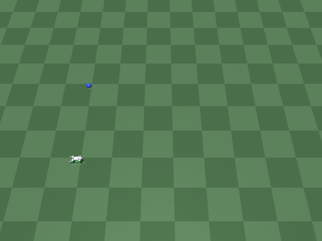
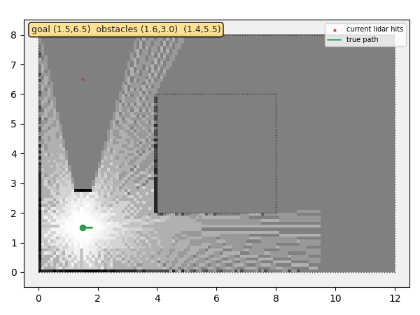

# World Action Model (WAM)

A learned forward-dynamics "world model" for the Unitree Go2 quadruped: given the robot's
current state and a commanded action, predict what state comes next -- without running the
real physics simulator. Trained entirely on rollout data collected from the sibling
`go1_rl_walk` project's own MuJoCo Go2 + classical convex-MPC controller.

A separate project (and repo) from `go1_rl_walk` and `slam_sim` (sibling directories),
following the same convention: each new kind of problem gets its own repo, not a branch of
an existing one.

## Scoping decisions

- **Data source: reuse the real Go2 quadruped, not a toy environment.** `go1_rl_walk/mpc`'s
  `MPCResidualEnv` (real MuJoCo rigid-body dynamics + classical convex-MPC balance/footstep
  control) is already a working, verified simulator -- generating rollouts from it means the
  world model learns real quadruped dynamics (stance-phase impacts, balance recovery, slip)
  from the start, not an idealized toy. Zero files in `go1_rl_walk` are modified; this
  project only ever imports from it, the same convention `slam_sim`'s Stage 6+ established.
- **Action = the velocity command, not the 12-dim residual torque.** `MPCResidualEnv` has
  two control levers: `env.step(residual_action)` (a 12-dim per-tick torque correction on
  top of the MPC) and `env.set_command(speed, lateral, yaw_rate)` (the 3-dim target
  velocity the MPC steers toward). Every demo across `go1_rl_walk` and `slam_sim` that
  reached a final, adopted state used `residual_action = 0` (pure classical MPC, no RL
  correction) -- so the 3-dim velocity command is the control lever actually in use, and
  the natural "action" for a world model meant to eventually support planning/navigation
  (Stage 2's goal) the same way `go1_rl_walk/mpc/navigate_mpc.py` already does by hand.
- **State = a reduced physical state, not the full 47-dim RL observation.** `MPCResidualEnv`'s
  own observation already bundles `[v_body(3), w_body(3), roll, pitch, qpos(12), qvel(12),
  mpc_tau(12), cmd(3)]` (47 dims) -- this project predicts everything except `mpc_tau` (an
  internal control signal, not "world state") and `cmd` (that's the action, not something to
  predict), plus `base_height` (tracked separately in `info`, not in `obs`). 33 dims total:
  `[v_body(3), w_body(3), roll, pitch, base_height, qpos(12), qvel(12)]`.
- **Predict state DELTAS at a 50ms macro-step, not raw next-state at the 5ms physics tick.**
  `MPCResidualEnv` runs its control loop at 200Hz (5ms/tick) -- predicting a single tick's
  change is almost an identity function (not a meaningfully hard or demonstrable learning
  problem) and too fine-grained for a future planner to reason about. Every 10 physics
  ticks (50ms), with the velocity command held constant across them, is recorded as one
  world-model transition `(state_t, action, state_{t+1})` -- a timescale closer to what
  `go1_rl_walk`'s own navigation loop already re-plans at.
- **Low-dimensional state prediction first, not pixels or a learned latent space.** The
  simplest version of this problem (direct state-to-state regression, a small MLP) gets
  built and verified before anything more ambitious -- same staged discipline as
  `slam_sim`'s own kinematic-robot-first choice. (Stage 12 revisits this deliberately, as a
  separate, explicitly-scoped exploration once Stages 1-11 were settled -- not a reversal of
  this choice for the existing planner/navigation work, which keeps using low-dim state.)
- **Stage 1 = prediction only; Stage 2 = use it for planning.** Verify the learned model's
  open-loop rollouts actually track the real simulator's before building anything on top of
  it. Only once that's trustworthy does it make sense to use the model for something (e.g.
  a learned-model MPC/planner, replacing or augmenting `navigate_mpc.py`'s hand-designed
  steering law) -- a user-requested two-part plan ("do 1 then 2"), not a speculative
  extension tacked on early.

## Staged plan

1. **Data collection + a simple MLP dynamics model, verified by open-loop rollout
   comparison against the real simulator** -- DONE.
2. **Use the learned model for planning/control** -- DONE.
3. **Obstacle-aware planning, reusing `slam_sim`'s lidar + occupancy map** -- DONE, including
   a follow-on fix (Stage 3b: A* global waypoints) for the corner-stall limitation found
   during Stage 3 itself.
4. **Extend to uneven terrain** -- DONE (partial/honest result, see below).
5. **Combine obstacle-aware planning with uneven terrain** -- DONE (found and fixed a real
   teleport/terrain-height bug along the way; honest bounded result, see below).
6. **A history-conditioned, action-chunked world model** -- DONE (clear rollout-accuracy
   win once scaled up; no downstream navigation win, and slower planning; see below).
7. **Tackle the planner's dead-reckoning error directly** -- DONE (two well-measured,
   negative/harmful results; investigation closed, see below).
8. **A moving obstacle** -- DONE (needed retuning for reaction speed, not cost weights;
   real load-bearing result once tuned, see below).
9. **Velocity-extrapolated obstacle prediction** -- DONE (first attempt regressed safety;
   diagnosed and fixed a footprint-radius gap, then a real if narrow improvement; see below).
10. **TWO independently-moving obstacles** -- DONE (architecture generalizes safely; found
    and fixed two real tracker bugs; Stage 9's extrapolation win doesn't clearly repeat, a
    genuine wash; see below).
11. **Fix Stage 10's indecisive-lingering mechanism directly** -- DONE (hysteresis/smoothness
    term implemented, tuned, measured twice -- inconclusive, closed; see below).
12. **Pixel-rendering mini-plan: onboard camera, a small dataset, an encoder sanity check,
    a frozen-latent dynamics check, a joint-training attempt, an isolating experiment, the
    H-step rollout loss fix, three ways to get a stronger signal, a usability check, a
    latent-space cost head for CEM speed, a turning-inclusive diversity dataset, and finally
    wiring it into a real CEM planner** -- DONE AND CLOSED (camera infra + a real rendering bug found
    and fixed + a small autoencoder learns real structure + a frozen-encoder latent dynamics
    model shows a weak one-step win but degrades fast under rollout + joint training doesn't
    fix that rollout degradation on flat ground + the SAME method clearly works on a
    deliberately easy wall-approach scenario, confirming the earlier failures were about signal
    strength/task difficulty, not a broken method + adding the H-step rollout loss (Stage 1's
    own fix for the same failure mode) measurably improves multi-step rollout accuracy on BOTH
    datasets and visibly cleans up compounding noise on the wall-approach data, but still can't
    manufacture a visually coherent rollout from flat ground's inherently weak signal +
    training on DEPTH instead of RGB is a dramatic win where there's a real distance to track
    (~9x over baseline, the best result in the whole mini-plan) but roughly neutral on flat
    ground (depth there is nearly constant, not noisy) + a diff-weighted loss is a null result
    on flat ground but a modest extra boost where signal is already strong + a richer,
    randomized-start/speed dataset confirms the wall-approach win generalizes beyond one
    memorized trajectory, at a smaller margin + a standalone checkpoint evaluator shows every
    tested checkpoint already holds up to a 20-step rollout with no retraining needed, though
    depth's huge margin shrinks substantially once combined with the varied dataset + a
    latent-space cost head reads a planning-relevant cost (min-depth to nearest obstacle)
    straight off a predicted latent with the decoder never called, staying correlated with
    ground truth out to a 20-step rollout and scoring 1000 candidates x 15 steps **946x faster**
    than decoding every step -- CEM-speed is no longer a blocker either + a genuinely
    open-ended, turning-inclusive exploration dataset (random start pose/heading near a wall,
    random speed/lateral/yaw_rate resampling, not a scripted straight-line approach) closes
    the data-diversity gap, at the cost of a much weaker one-step margin (barely beats
    baseline) and the cost head's rollout correlation collapsing far faster than the earlier
    single-scenario result (0.80/0.53/0.35 at steps 1/2/3, not 0.97 holding to 20) + wiring the
    cost head into wam/planner.py's CEMPlanner (a new, capped-horizon camera-only obstacle
    term, alongside -- not replacing -- the state model's own goal/pose/stability cost) and
    testing it in navigate_wam_pixel.py on the SAME island-routing task Stage 3 already uses +
    step 18 found and fixed a real bug (CEMPlanner's torch sampling was never seeded, so the
    step 17 comparison above partly measured CEM noise, not a real effect -- corrected), tried
    a corner-biased dataset (a NEGATIVE result -- made the dynamics model fit worse, not
    better), retargeted the cost head from a near-collision-only signal to a genuine
    multi-meter one (step 15-17's "min-depth" was mostly the camera's own near-field ground-
    plane reading; "far-depth" tracks wall distance smoothly from 3.62m down), and, with CEM's
    sampling properly controlled, directly observed the camera term WORKING (a real reaction
    right at the critical moment) but still insufficient alone -- a purely reactive, memory-
    less correction, exactly Stage 3's original pre-A* failure mode, now confirmed rather than
    assumed + step 19 built that exact fix (a camera-derived occupancy map feeding wam/
    global_planner.py's A* completely unmodified) and confirmed it WORKS as a mechanism (real
    waypoints, the robot visibly executing deliberate detour maneuvers) but still doesn't
    improve the measured outcome -- a single coarse forward beam per replan makes the map too
    sparse/noisy for A* to converge on one stable route (the chosen waypoint was observed
    oscillating between routing north and south across consecutive replans), unlike lidar's
    full sweep per scan + step 20 tried the direct fix (7 beams spread across the camera's
    ~45deg FOV instead of 1), confirmed it measurably stabilizes the map (long stable stretches
    replace near-every-replan flip-flopping) but STILL doesn't fix the outcome -- all seeds
    still fall or time out, at comparable final distances to step 19, with the camera reactive
    term often not even engaging on the run that fails -- map sparsity was A real contributor,
    not THE whole story -- closed here: steps 17-20 tried and resolved seeding, cost-head
    target, corner-biased data, global planning, and sensing density in turn, without ever
    moving the headline navigation outcome, a reasonable stopping point absent a genuinely new
    hypothesis; see below).
13. **Replace ground-truth pose with a real, noisy/drifting SLAM belief pose** -- DONE (a
    clean, decisive positive result -- see below).

### Stage 1: data collection, training, and open-loop verification

`collect_data.py` ran 50 training + 10 validation episodes (10s each, real Go2 + classical
MPC, random held-then-ramped velocity commands -- see "Scoping decisions"), yielding 9,806
training / 1,855 validation transitions (a handful of episodes fell short of the full 200
transitions/episode: rarer falls even with the ramped commands, discarded rather than kept
as contaminated data).

**First attempt (one-step loss only) failed open-loop, in an instructive way.** Training
`wam/model.py`'s MLP purely on one-step `(state, action) -> next_state` prediction looked
great by the metric it was trained on (val one-step MAE 0.16), but `eval_rollout.py`'s real
test -- feed the model's own predictions back in autoregressively for a full 10s, 200-step
held-out episode, no peeking at ground truth -- told a different story: it tracked the real
simulator closely for about 8 seconds, then **blew up exponentially** (roll reaching 6 rad,
base height "climbing" past 2m by t=10s). Overall rollout RMSE: 8.71. This is the classic
compounding-error failure mode of autoregressive models trained only on one-step loss, not
a bug in the data or the env -- confirmed by the plot showing a clean, accurate trajectory
for most of the episode before the error visibly starts compounding near t=8s.

**Fix: train with an H-step rollout loss, not just one-step.** `train_world_model.py` now
trains on a COMBINATION of the one-step loss (cheap, stable gradient) and a 20-step
(1.0s) autoregressive rollout loss -- unrolling the model itself during training and
penalizing the full trajectory's error, not just a single step's, the same approach
model-based RL methods (PETS, MBPO, Dreamer) use for exactly this reason. Result: overall
rollout RMSE dropped from 8.71 to **0.44** (20x), with every plotted quantity (base height,
roll, pitch, forward velocity, yaw rate) tracking the real simulator closely across the
*entire* 10-second, 200-step held-out episode -- no blowup. The model catches one real
transient (a ~0.03m base-height bounce around t=2.3s) a bit late but recovers and keeps
tracking afterward.

<p align="center">
  
</p>

Needs `go1_rl_walk/mpc`'s own venv (`mujoco`, `torch`, `casadi`/`pinocchio` all live there):

```bash
/home/cstu/robo/go1_rl_walk/mpc/venv/bin/python3 collect_data.py \
    --episodes 50 --val-episodes 10 --out data/rollouts.npz
/home/cstu/robo/go1_rl_walk/mpc/venv/bin/python3 train_world_model.py \
    --data data/rollouts.npz --checkpoint checkpoints/world_model.pt
/home/cstu/robo/go1_rl_walk/mpc/venv/bin/python3 eval_rollout.py \
    --checkpoint checkpoints/world_model.pt --record media/rollout_comparison.png
```

### Stage 2: a learned-model CEM planner, replacing the hand-designed steering law

The world model's own 33-dim state has no world-frame `(x, y, yaw)` in it (by design -- see
"Scoping decisions"), so a planner that wants to reason about a world-frame goal has to
dead-reckon pose itself from the state components the model *does* predict: body-frame
forward/lateral velocity and yaw-rate, integrated forward each step (`wam/pose.py`, same
body->world rotation convention `mpc_residual_env.py` itself uses). The planner
(`wam/planner.py`'s `CEMPlanner`) is a standard shooting method: sample many candidate
*constant* velocity commands, roll each one forward through the learned model for a short
horizon (10 macro-steps = 0.5s) while dead-reckoning pose alongside it, score each rollout
by final distance-to-goal + heading alignment + a stability penalty (keeping roll/pitch/
height near the training distribution's own typical standing values, since the model was
never trained on falls and can't be trusted to extrapolate into them), keep the best-scoring
"elite" samples, refit the sampling distribution around them, and repeat for 3 iterations
(cross-entropy method). Candidates are a single constant command across the whole horizon,
not a freely time-varying sequence, deliberately: Stage 1's training data only ever changed
its target command every 0.5s, so a constant-command rollout matches what the model
actually saw during training, where a faster-switching sequence would ask it to extrapolate
beyond its own training distribution.

`navigate_wam.py` drives the real Go2 (same zero-RL-residual, classical-MPC convention as
every other script here) toward a world-frame goal by replanning every 0.25s (5 macro-steps)
with the CEM planner and holding its chosen command in between (rate-limited the same way
`navigate_mpc.py`'s is, for the same QP-stability reason). Every tick still reads the REAL
ground-truth pose from the simulator for "where am I now" -- only the planner's internal
look-ahead rollout uses the learned model and its own dead-reckoned pose estimate to score
candidates.

**Evaluated against `go1_rl_walk/mpc/navigate_mpc.py`'s two hand-designed steering laws**
(`strafe`: the original crab-toward-goal law; `turn`: turn-to-face + drive forward), across
10 randomized (seed, goal) trials -- same seeds/goals for all three methods, goals 1.5-3.0m
away in a random direction, so the same initial state and target set is attempted by all
three. See "go1-eval-method": judged across repeated randomized trials, not a single run.

| method      | success | mean time-to-reach | mean final distance |
|-------------|---------|---------------------|----------------------|
| **wam (CEM planner)** | **10/10** | **3.28 s** | **0.043 m** |
| mpc strafe  | 10/10   | 5.27 s              | 0.136 m              |
| mpc turn    | 10/10   | 4.56 s              | 0.154 m              |

All three reached every one of the 10 goals with zero falls -- the learned-model planner is
just as reliable as the hand-designed laws here, and noticeably faster and more precise:
~30-38% faster to reach, and 3-4x tighter on final distance (closer than the 0.15m arrival
tolerance itself, vs. the analytic laws settling right around it). The gap is plausible, not
just noise: the CEM planner jointly optimizes all 3 command dimensions (speed, lateral,
yaw-rate) against the actual predicted outcome every replan, where `compute_nav_command`/
`compute_nav_command_turn` are decoupled proportional laws recomputed from instantaneous
error alone. Reproduce with:

```bash
/home/cstu/robo/go1_rl_walk/mpc/venv/bin/python3 eval_navigate.py \
    --trials 10 --seconds 15 --base-seed 200 --goal-seed 7
```

<p align="center">
  
</p>

```bash
/home/cstu/robo/go1_rl_walk/mpc/venv/bin/python3 navigate_wam.py \
    --goal-x 3.0 --goal-y 1.0 --checkpoint checkpoints/world_model.pt --record out.gif
```

### Stage 3: obstacle-aware planning, reusing `slam_sim`'s lidar + occupancy map

Everything sensing/mapping-related here is reused COMPLETELY UNMODIFIED from the sibling
`slam_sim` project's own earlier stages, not re-derived: `slam.world.World.loop_corridor()`
(a 12x8m rectangle with a 4x4m island in the middle -- a straight line between opposite
corners is blocked, forcing genuine routing around it), `demo_stage6_go2_world.py`'s
`build_env_xml`/wall-injection for putting that island into the real Go2's MuJoCo scene,
`slam.mj_lidar.mj_lidar_scan`'s real ray-cast lidar, and `slam.occupancy_grid.OccupancyGrid`
for the log-odds map those scans build up over time. This stage only adds the planning
side: `wam/planner.py`'s `CEMPlanner` now accepts an `obstacle_points` argument (the
occupancy grid's currently-known occupied cell centers) and scores every candidate
rollout's predicted (x, y) against the nearest one -- a soft quadratic penalty inside a
0.5m safety margin, plus a large flat penalty if a rollout predicts actually crossing a
0.35m collision margin. Deliberately uses the REAL ground-truth pose (not `slam_sim`'s own
ICP-corrected belief pose) to build the map -- localization-under-drift is a separate,
already-solved problem over in `slam_sim`'s Stage 4/6; this stage's new ground is planning
around what's been sensed, not re-demonstrating localization. One real consequence: the map
only contains what's been scanned so far, so the planner can only avoid what it has already
seen, same as any real lidar-then-plan stack.

**Confirmed the obstacle cost is actually necessary, not just harmless:** with it disabled
(`--disable-obstacle-cost`, Stage 2's planner unchanged), the robot drives straight at the
island and falls/QP-fails almost immediately (final distance 7.6-7.8m from a ~10.3m start).
With it enabled, the same goal is reached safely, routing around the island:

<p align="center">
  
  
</p>
<p align="center">
  
</p>

**Evaluated across 4 start/goal pairs in the same world** (one with no obstacle in the way,
as a sanity check the planner doesn't detour needlessly; three forcing a real detour around
different sides/corners of the island):

| start &rarr; goal | obstacle in the way? | result |
|---|---|---|
| (1.5,1.5) &rarr; (1.5,6.5) | no (clear corridor) | reached in 5.9s -- no needless detour |
| (1.5,1.5) &rarr; (10.5,6.5) | yes | reached in 30.5-31.6s (reproduced twice) |
| (10.5,1.5) &rarr; (1.5,6.5) | yes | safe, but did not finish in 45s (final distance 2.96m) |
| (1.5,6.5) &rarr; (10.5,1.5) | yes | safe, but did not finish in 45s (final distance 7.02m) |

Zero falls across all 4 trials, including the two that didn't finish -- the obstacle cost's
core safety claim held in every case. But it's not a uniformly efficient router: the two
unfinished trials both stall near a sharp convex corner of the island, creeping at a few
cm/s rather than committing to a decisive turn around it (one of these, given more time,
eventually broke free and finished at 31.3s -- not stuck forever, just slow and
inconsistent). This is a real, explainable limitation of this specific design, not a bug:
the obstacle cost only ever looks at where the planner's own SHORT (0.5s), DEAD-RECKONED
rollout predicts the robot will be -- near a sharp corner, small pose-integration error
inside that short horizon can make a genuinely-clear turn look like it still clips the
safety margin, so the CEM settles for a locally-safe near-zero-progress crawl instead.

```bash
/home/cstu/robo/go1_rl_walk/mpc/venv/bin/python3 navigate_wam_obstacles.py \
    --goal-x 10.5 --goal-y 6.5 --checkpoint checkpoints/world_model.pt \
    --record-robot media/robot.gif --record-map media/map.gif
```

#### Stage 3b: A* global waypoints fix the corner-stall

`wam/global_planner.py` adds exactly the fix flagged above: A* over the SAME occupancy grid
(obstacle cells inflated by the robot's own collision margin), simplified by greedy
line-of-sight "string-pulling" down to a handful of long, direct legs. Recomputed from
scratch every CEM replan (receding-horizon, no waypoint-index state to carry across ticks --
cheap on a map this size, ~10k cells). The CEM is then handed the nearest waypoint still in
line-of-sight of the robot's current position as its goal, instead of the raw (possibly
far-away, behind-a-corner) true goal -- so it only ever has to solve the easy local problem
of walking a mostly-straight line, never "route around this obstacle" from scratch under a
0.5s dead-reckoned horizon.

<p align="center">
  
  
</p>

**Multi-seed before/after on the same 4 start/goal pairs** (3 seeds each, `eval_obstacles.py`):

| start &rarr; goal | A* disabled (Stage 3 original) | A* enabled (Stage 3b) |
|---|---|---|
| no obstacle (sanity check) | reached in 5.9-6.0s (all 3 seeds) | reached in 5.9-6.0s (all 3 seeds, unchanged) |
| detour A | reached in 29.7-31.4s | reached in **14.3-14.4s** |
| detour B (corner-stall case) | 2/3 seeds timed out (d=1.68-7.06m); 1 reached @39.9s | reached in **17.4-17.5s, all 3 seeds** |
| detour C (corner-stall case) | 2/3 seeds timed out (d=7.04-7.07m); 1 reached @40.5s | reached in **13.6-14.3s, all 3 seeds** |

12/12 trials reach the goal with A* enabled (up from 4/12 without it), roughly 2x faster
even on the detour that didn't stall before, and the no-obstacle sanity check is completely
unchanged -- confirming A* isn't adding needless detours where none are required. Zero falls
in any trial, either condition. Reproduce with:

```bash
/home/cstu/robo/go1_rl_walk/mpc/venv/bin/python3 eval_obstacles.py \
    --seeds 3 --base-seed 100 --seconds 45
```

### Stage 4: extend to uneven terrain -- a genuine but partial result

`MPCResidualEnv`'s own `terrain_amplitude_range` constructor argument already resamples a
fresh random bump amplitude at every `reset()` (same mechanism it uses for
speed/lateral/yaw-rate ranges) -- so `collect_data.py` and `eval_rollout.py` both gained a
`--terrain-amplitude-max` flag that just threads a `(0.0, max)` range through, no new
terrain-generation code needed.

**Confirmed the generalization gap first, not assumed it:** Stage 1's flat-only checkpoint's
open-loop rollout RMSE on terrain (0.08m bumps) is meaningfully worse than on flat ground --
across 6 held-out seeds, mean RMSE 0.62 (flat) vs. **1.33** (terrain), driven mostly by leg
joint-velocity error (qvel RMSE up to ~1.5-2x worse per-joint on terrain). Expected: terrain
disturbances are an exogenous input the model never saw, not something the (state, action)
pair alone can anticipate.

**Collected a terrain-inclusive dataset and retrained** (`collect_data.py --terrain-amplitude-
max 0.08`, 50 train + 10 val 10s episodes, 9708/1928 transitions -- comparable size to Stage
1's flat dataset). The first training run surfaced a real instability: `one_step_loss` and
`rollout_train_loss` both suddenly spiked ~8x around epoch 100 (one outlier batch through the
H-step rollout loss's repeated model composition producing an unusually large gradient --
not seen on flat data, where the gradient magnitudes stay smaller throughout) and only
partially recovered by epoch 199. **Fixed with gradient-norm clipping** (`--grad-clip 1.0`,
now on by default in `train_world_model.py`) -- the retrained run's loss curve was smooth
throughout, with a better best checkpoint (val rollout MAE 0.297 vs. 0.340 without clipping).

**Evaluated across 6 held-out seeds per condition** (`eval_terrain.py`), not a single
episode -- a single episode's RMSE was actually MISLEADING here: the first terrain-trained
checkpoint happened to score *better* than the flat checkpoint on one specific held-out
episode and *worse* on another, which would have supported opposite conclusions depending
on which seed got tested. See [[go1-review-before-trusting]].

| condition | mean RMSE | std |
|---|---|---|
| flat-trained model, flat ground | 0.62 | 0.23 |
| flat-trained model, terrain | 1.33 | 0.73 |
| terrain-trained model, flat ground | 0.86 | 0.35 |
| terrain-trained model, terrain | 1.03 | 0.43 |

**Honest conclusion: a real but partial improvement, not a clean fix like Stages 1-3.**
Training on terrain data measurably helps on terrain (mean RMSE down ~22%, std down ~40% --
fewer of the occasional much-worse episodes the flat model produced on terrain) but doesn't
fully close the gap back to flat-ground-level accuracy, and costs a real regression on flat
ground itself (0.62 -> 0.86). This is the ordinary cost of broadening a training
distribution to cover a harder case, not a bug -- the same trade-off `go1_rl_walk`'s own
flat-vs-random-terrain RL staging ran into (see [[go1-staged-plan]]).

**At the downstream navigation level, this difference didn't clearly show up.** Ran
`navigate_wam.py` with `--terrain-amplitude 0.08` across the same 5 (seed, goal) pairs for
both checkpoints: both reached 4/5 goals with similar times and final distances, and both
fell on the SAME seed (200) -- suggesting that particular terrain realization was just hard
for the real classical-MPC controller regardless of which learned model informed planning,
not a world-model-accuracy effect. The modest rollout-accuracy edge the terrain-trained
model has didn't translate into a visibly better navigation success rate at this sample
size -- a genuinely inconclusive result at the planning level, reported as such rather than
rounded up to a win.

```bash
/home/cstu/robo/go1_rl_walk/mpc/venv/bin/python3 collect_data.py \
    --terrain-amplitude-max 0.08 --episodes 50 --val-episodes 10 --out data/rollouts_terrain.npz
/home/cstu/robo/go1_rl_walk/mpc/venv/bin/python3 train_world_model.py \
    --data data/rollouts_terrain.npz --checkpoint checkpoints/world_model_terrain.pt
/home/cstu/robo/go1_rl_walk/mpc/venv/bin/python3 eval_terrain.py --trials 6
```

<p align="center">
  
</p>

### Stage 5: obstacle-aware planning on uneven terrain -- combining Stage 3b + Stage 4

Neither prior stage tested this combination: Stage 3/3b's island world was flat ground, and
Stage 4's downstream navigation check used the open, obstacle-free default world. `navigate_
wam_obstacles.py` gained the same `--terrain-amplitude-max` passthrough as `collect_data.py`/
`eval_rollout.py`, so the same island-plus-walls world used for obstacle avoidance can also
have Stage 4's 0.08m random bumps.

**Found and fixed a real bug this surfaced, not a planning/dynamics result:** the script
teleports the robot to `--start-x/-y` after `env.reset()` by directly overwriting `qpos[0:2]`
-- on flat ground this is harmless (ground height is 0 everywhere), but with terrain enabled
it left `qpos[2]` (base height) set for the DEFAULT spawn point's terrain height, not the new
start point's. Every affected trial fell within ~0.1-0.2m of start (confirmed: final distance
after "falling" was ~4.8-4.9m out of a ~5.0m straight-line start-to-goal distance -- the
robot barely moved before an instant, violent contact from spawning embedded in or floating
above a terrain bump). **Fixed** by reading the terrain height at both the pre- and
post-teleport position and shifting `qpos[2]` by the difference -- a no-op when terrain is
disabled (both heights are 0), so Stage 3/3b's own flat-ground behavior is unaffected.

**With that fixed, ran the real multi-seed comparison** (same 4 start/goal pairs, 3 seeds,
both world-model checkpoints, terrain amplitude 0.08 -- `eval_obstacles_terrain.py`):

| condition | trials reached |
|---|---|
| flat-trained model, obstacles + terrain | 5/12 |
| terrain-trained model, obstacles + terrain | 3/12 |

A much higher fall rate than either capability alone (Stage 3b: 12/12 on flat ground; Stage
4's downstream check: 4/5 on open terrain with no obstacles) -- obstacle avoidance's sharper
turns near walls, combined with real ground disturbance, is a genuinely harder combination.
Notably, the SAME seeds fell for both checkpoints at similar final distances -- pointing away
from "the world model's predictive accuracy is the bottleneck" (which checkpoint is loaded
barely matters) and toward the classical MPC's footstep planner, which by default assumes
flat touchdown height regardless of terrain (same naive-footstep design `go1_rl_walk`'s own
Stage 11 terrain work already identified and built a fix for).

**Reused that existing fix, unmodified**: `MPCResidualEnv`'s own `terrain_footstep_planning`
flag (already implemented and validated in `go1_rl_walk`, just not previously threaded
through this script) makes the footstep planner terrain-aware instead of assuming flat
ground. Re-ran the same comparison with it enabled:

| condition | trials reached |
|---|---|
| flat-trained model, obstacles + terrain, footstep-planning ON | 6/12 |
| terrain-trained model, obstacles + terrain, footstep-planning ON | 6/12 |

A real, replicable improvement (5/12 and 3/12 &rarr; 6/12 both) -- but not a full fix: one
terrain draw (seed 301) fails on every single start/goal pair for both checkpoints even with
footstep-aware planning, matching `go1_rl_walk/mpc`'s own documented finding that terrain-
aware footstep planning alone still leaves a substantial QP-failure rate on hard terrain.
Zero timeouts across all 48 trials in this stage (every result was either "reached" or
"fell") -- Stage 3b's corner-stall fix holds even here; the remaining failures are
terrain-induced falls, a different and lower-level problem than path planning.

**Honest conclusion**: obstacle-aware planning and terrain generalization each work well on
their own, but stacking them is a genuinely harder problem that neither this project's
learned world model nor its CEM/A* planner can fix alone -- the bottleneck is the classical
MPC's terrain-robustness, a `go1_rl_walk`-level limitation (already partially addressed
there, not fully solved) rather than something to chase further inside `wam`'s own scope.
Reporting this plainly rather than cherry-picking the footstep-planning-on numbers as a win.

```bash
/home/cstu/robo/go1_rl_walk/mpc/venv/bin/python3 eval_obstacles_terrain.py \
    --seeds 3 --base-seed 300 --terrain-amplitude-max 0.08 --seconds 45 \
    --terrain-footstep-planning
```

### Stage 6: a history-conditioned, action-chunked world model -- better predictions, no downstream win

User asked to try ideas from Physical Intelligence-style "action chunking" architectures
(pi0 and similar -- policy models, not dynamics models, but the same two ideas apply to a
dynamics model): (1) condition on a short HISTORY of past (state, action) pairs, not just
the instantaneous state, and (2) predict a whole CHUNK of future states jointly from a
chunk of future actions in ONE non-autoregressive forward pass, instead of calling a
single-step model repeatedly and feeding its own prediction back in.

`wam/chunked_model.py`'s `ChunkedWorldModel`: a small causal transformer over a token
sequence `[history_len past (state,action) pairs] + [current state, pivot] + [chunk_len
future actions]`. Each future position predicts its delta relative to the CHUNK'S OWN
START state (not the previous step -- the model never sees intermediate steps within one
forward pass, that's the actual point of non-autoregressive prediction). Trained on the
exact same data `collect_data.py` already produces (`train_chunked_world_model.py`), just
windowed differently -- no new data collection needed.

**First architecture (d_model=128, 2 layers) was only comparable to the existing MLP, not
better** -- 6 paired held-out seeds: chunked mean RMSE 0.594 vs. MLP's 0.560, 5 of 6 seeds
favoring the MLP. **Scaled up (d_model=256, 3 layers, more training epochs) and the result
flipped cleanly**: mean RMSE 0.441 vs. 0.560, **6 of 6 seeds** favoring the chunked model
(`eval_rollout_chunked.py`) -- a real, consistent ~21% improvement, not noise. The smaller
architecture was genuinely under-capacity, not evidence the underlying idea doesn't work.

```bash
/home/cstu/robo/go1_rl_walk/mpc/venv/bin/python3 train_chunked_world_model.py \
    --data data/rollouts.npz --checkpoint checkpoints/world_model_chunked_large.pt \
    --d-model 256 --n-heads 8 --n-layers 3 --d-ff 512 --epochs 300
/home/cstu/robo/go1_rl_walk/mpc/venv/bin/python3 eval_rollout_chunked.py \
    --chunked-checkpoint checkpoints/world_model_chunked_large.pt --seeds 6
```

**Built the planner integration anyway** (`wam/chunked_planner.py`'s `ChunkedCEMPlanner` +
`ChunkedHistoryBuffer`, `navigate_wam_chunked.py`) to see whether the clear accuracy win
translated downstream. It didn't, in either direction that matters:

| method | success | mean time-to-goal | mean final distance | mean `plan()` wall-clock |
|---|---|---|---|---|
| `navigate_wam.py` (single-step MLP) | 10/10 | 3.29s | 0.046m | 12ms |
| `navigate_wam_chunked.py` (chunked) | 10/10 | 3.30s | 0.064m | 164ms |

Same 10 seeds/goals as Stage 2's own comparison. Success and time-to-goal are
essentially identical; final-distance precision is slightly worse for the chunked
planner (still well inside the 0.15m arrival tolerance, not a meaningful difference in
practice); and the chunked planner's `plan()` call is **~13x slower** despite needing
only 1 batched model call per horizon instead of 10 -- the transformer's per-call cost
dominates over the savings from fewer calls, at least at this model size and `n_samples`.

<p align="center">
  
</p>

```bash
/home/cstu/robo/go1_rl_walk/mpc/venv/bin/python3 navigate_wam_chunked.py \
    --goal-x 3.0 --goal-y 1.0 --seed 200 \
    --checkpoint checkpoints/world_model_chunked_large.pt --record media/navigate_wam_chunked_robot.gif
```

**Honest conclusion**: a genuinely better predictive model (clearly verified, 6/6 seeds)
did not produce a better planner, and cost real planning speed -- the same "model
accuracy isn't the bottleneck" lesson Stage 4/5 already found with the terrain-trained
checkpoint, now showing up again with a structurally different model. Kept as working,
verified infrastructure (not deleted), not adopted as the default checkpoint/planner.

```bash
/home/cstu/robo/go1_rl_walk/mpc/venv/bin/python3 navigate_wam_chunked.py \
    --goal-x 3.0 --goal-y 1.0 --checkpoint checkpoints/world_model_chunked_large.pt
```

### Stage 7: tackled the planner's dead-reckoning error directly -- two negative results, closed

`wam/pose.py`'s `integrate_pose` is only ever evaluated inside a CEM rollout, 10 macro-steps
(0.5s) deep per candidate, using the model's own autoregressively-predicted velocities --
Stage 3's corner-stall writeup flagged "small pose-integration error" as a plausible
contributor to the planner's limitations without ever isolating it. User asked to tackle this
directly rather than keep treating it as a vague caveat.

**Experiment 1 -- is the Euler integration SCHEME itself the problem?** Added
`integrate_pose_exact`, a closed-form unicycle-arc integration (accounts for yaw continuously
rotating across the 50ms step, instead of freezing it at the step's start like forward-Euler
does) and built `eval_pose_integration.py`: using 200 real held-out hold-blocks (6 seeds) --
each one a natural, already-labeled instance of exactly what the planner tries to predict
(0.5s under one constant command) -- it compares four horizon-matched final-position
estimates against real ground truth:

| estimate | mean error |
|---|---|
| integration-only, Euler, given REAL velocities | 0.0141m |
| integration-only, exact-arc, given REAL velocities | 0.0140m |
| full rollout (model-predicted velocities), Euler [current] | 0.1178m |
| full rollout (model-predicted velocities), exact-arc | 0.1180m |

**Finding: the integration scheme contributes almost nothing** (0.014m either way, a 1mm
difference -- noise). The real error, ~8x larger, is the world model's own compounding
autoregressive prediction error over the 10-step rollout; swapping in exact-arc integration
doesn't help there either (95/200 blocks better, 105/200 worse, mean delta -0.0002m). Ruled
out cleanly, not assumed.

```bash
/home/cstu/robo/go1_rl_walk/mpc/venv/bin/python3 eval_pose_integration.py \
    --checkpoint checkpoints/world_model.pt --seeds 6
```

**Experiment 2 -- does shortening the horizon (less model-compounding error per rollout)
help downstream?** `navigate_wam.py` already exposes `--horizon-steps` (default 10 = 0.5s)
independently of `--replan-every` (5 macro-steps = 0.25s) -- the CEM commits to a full 0.5s
of imagined rollout even though only half that time elapses before the next real-state
correction. Shortening `horizon_steps` to 5 (matching the replan cadence exactly) should, by
Experiment 1's own measurement, roughly halve the model-compounding error each rollout
accumulates. Tested on the same 10-seed/goal protocol Stage 2/6 already use:

| horizon_steps | success | mean time-to-reach | mean final distance |
|---|---|---|---|
| 10 (current default) | 10/10 | 3.29s | 0.049m |
| 5 (matches replan cadence) | **9/10 (1 fall)** | 3.38s | **0.175m** |

**It backfired.** Shortening the horizon made things measurably worse, not better -- one
real fall (none before), final-distance precision nearly 4x worse, time-to-goal essentially
unchanged. Most likely explanation: CEM needs enough lookahead for a candidate command's
effect (through inertia/turning) to meaningfully separate it from its neighbors in the
sampling distribution -- a shorter horizon starves the cost function of that separation, so
it starts ranking candidates on noise rather than real differences, even though each
individual rollout's own absolute position estimate is less eroded by compounding error.

```bash
/home/cstu/robo/go1_rl_walk/mpc/venv/bin/python3 eval_navigate.py \
    --trials 10 --seconds 15 --base-seed 200 --goal-seed 7 --methods wam --horizon-steps 5
```

**Honest conclusion, investigation closed**: two concrete, well-measured attempts at
"dead-reckoning error" as a fixable planner-mechanics issue came back negative -- one inert
(integration formula), one actively harmful (shorter horizon). This is the same recurring
theme as Stage 4/5/6: the planner's absolute internal position error isn't actually what
limits downstream performance -- what matters more is the CEM having enough lookahead to
rank candidates well. Treating this track as closed (same precedent as `go1_rl_walk`'s
terrain-MPC investigation) rather than trying a third variant without a genuinely new idea.
Kept `integrate_pose_exact` and `eval_pose_integration.py` as working, verified diagnostic
infrastructure (not deleted); `horizon_steps`/`--horizon-steps` stay at their original
default of 10.

### Stage 8: a MOVING obstacle -- the sense-then-plan pipeline handles it, if tuned to react

Every obstacle through Stage 3/3b/5 was static. This stage adds exactly one obstacle that
moves, to stress-test the lidar -> occupancy-grid -> A*/CEM-obstacle-cost pipeline against
something that isn't where the last scan saw it -- a genuinely different regime than "map it
once, then plan around a fixed map."

**Moving it at all needed a MuJoCo mechanism check first.** A plain `<geom>` under
`<worldbody>` (what every static wall/island geom already is, via
`demo_stage6_go2_world.py`'s `inject_walls`) is permanently welded to the world at compile
time -- nothing can move it afterward. `wam/moving_obstacle.py`'s `MovingObstacle` instead
injects a MuJoCo **mocap body** (no joint/inertia; its pose is written directly into
`data.mocap_pos` every tick, not simulated), oscillating sinusoidally along one axis.
Confirmed directly (not assumed) that `slam.mj_lidar.mj_lidar_scan`'s `mj_ray` call reads
live geom transforms on every call (so the lidar sees the moved obstacle with zero changes
needed there) and that `slam.occupancy_grid.OccupancyGrid.update` already does log-odds
free-space clearing along each beam (so a cell the obstacle has moved away from decays back
toward "free" over a few scans, rather than leaving a permanent ghost trail) -- both reused
completely unmodified, same convention every earlier stage follows for `slam_sim` code.

**Default scenario**: reuses `eval_obstacles.py`'s own "no obstacle (sanity check)" pair --
(1.5, 1.5) &rarr; (1.5, 6.5), a straight line through open space with nothing static in the
way -- and adds one obstacle centered on that line's midpoint, sweeping back and forth across
it. What was a trivial, obstacle-free sanity check becomes a genuine dynamic-avoidance test:
the line is clear most of the time, periodically blocked.

<p align="center">
  
  
</p>

**First attempt at default settings (0.8m amplitude, 6s period, Stage 3's 0.25s replan
cadence) was unsafe**: across 7 phase offsets, 3 ended in a real physical fall (the obstacle
has real collision geometry, same `contype`/`conaffinity` as the walls -- a "fall" here means
an actual collision, not just a bad cost). **Tuned three things, not the obstacle cost
weights**: slowed the sweep (6s -> 10s period), replanned more often (`--replan-every` 5 ->
2 macro-steps -- the replan CADENCE, not the rollout horizon Stage 7 already found shouldn't
be shortened), and widened the safety margin slightly (0.5m -> 0.6m). Result: 7/7 across the
same phases, all comfortably clear (worst-case min-distance 0.64m).

**Multi-seed/phase verification that the obstacle cost is actually load-bearing against a
moving obstacle, not just a static one** (8 phases spanning a full sweep cycle,
`eval_moving_obstacle.py`):

| condition | success | fell | mean min-distance to obstacle | worst-case min-distance |
|---|---|---|---|---|
| obstacle cost disabled (Stage 2 goal-only) | 4/8 | 4 | 0.74m | 0.49m |
| obstacle cost enabled (Stage 8) | **8/8** | **0** | 0.82m | 0.60m |

```bash
/home/cstu/robo/go1_rl_walk/mpc/venv/bin/python3 eval_moving_obstacle.py \
    --trials 8 --seconds 25 --base-seed 300
```

**Honest conclusion**: the same sense-then-plan pipeline built for a static island generalizes
to a moving obstacle, but only once retuned for reaction speed (faster replanning) rather than
made more cautious in the cost function alone -- the planner has no model of the obstacle's
own motion, it only ever reacts to where lidar last sensed it, so closing the sensing loop
faster mattered more than penalizing proximity harder. A real, load-bearing result (4/8 ->
8/8, with safer margins too), not a trivial extension.

### Stage 9: velocity-extrapolated obstacle prediction -- a real (if narrow) improvement, after fixing a self-inflicted regression

Stage 8's planner treats the moving obstacle as frozen at its last-sensed position for the
whole 0.5s rollout horizon -- a known, documented limitation. This stage gives the CEM
rollout a predicted FUTURE obstacle position instead, extrapolated from an estimated
velocity, re-evaluated at each rollout step's own future time rather than staying fixed.

**Still obeys the sense-then-plan rule**: `wam/obstacle_tracker.py`'s `DynamicObstacleTracker`
only ever looks at `OccupancyGrid.occupied_points()` -- it never imports or reads
`MovingObstacle`'s ground-truth position or its analytic motion model. The one new prior it
uses is a STATIC-only reference occupancy grid, built once at startup by lidar-scanning the
environment's known wall/island geometry from a grid of vantage points with no obstacle
present -- a reasonable "given a floor plan" assumption, not the same thing as knowing the
obstacle's own position or motion. Any live occupied point far enough from that static
reference is classified as a sighting of the moving obstacle; its centroid over successive
scans gives a position, and a (windowed, not consecutive-scan) finite difference gives a
velocity estimate. `wam/planner.py`'s `CEMPlanner.plan()` gained a `dynamic_obstacle=(pos,
vel)` argument that extrapolates this point forward per rollout step, on top of the existing
(now static-only) `obstacle_points` safety net.

**First attempt was a regression, not an improvement**: at the project's standard 8-phase/seed
protocol it was a wash (8/8 both ways, extrapolation actually slightly worse: 0.80m vs 0.85m
mean min-distance). Worse, a repeated-trial stress test at one scenario (seed=1, phase=0.5,
chosen because it happened to need a close pass) showed a REAL regression: 3/5 falls with
extrapolation on vs. 0/5 with it off, reproduced again after widening the velocity-estimation
window (ruled out noisy single-scan velocity estimates as the cause).

**Root cause, diagnosed not guessed**: `OccupancyGrid`'s imperfect/slow free-space clearing
means Stage 8's frozen `obstacle_points` set is actually a small CLUSTER of recently-occupied
cells spanning the obstacle's last few positions, not a literal single point -- it gets a
"free" safety margin from sensing lag that approximates the real object's physical width.
Collapsing sensed points down to a bare centroid and extrapolating that single point forward
threw this away, shrinking the avoided region from the real ~0.6m-wide obstacle down to a
zero-radius point. **Fix**: pass the obstacle's own known physical footprint radius
(`--obstacle-size`, already a CLI parameter, not new information) into the dynamic term's
safety/collision margins (`dynamic_obstacle_radius` in `CEMPlanner.plan()`) -- restoring an
explicit footprint instead of relying on accidental sensing-lag slack.

**Multi-seed/phase verification after the fix** (same 8-phase/seed protocol as Stage 8's own
table, `eval_obstacle_extrapolation.py`):

| condition | success | fell | mean min-distance | worst-case min-distance | mean time-to-reach |
|---|---|---|---|---|---|
| frozen at last-sensed position (Stage 8) | 8/8 | 0 | 0.84m | 0.57m | 8.05s |
| velocity-extrapolated (Stage 9) | 8/8 | **0** | **0.95m** | **0.73m** | **7.54s** |

```bash
/home/cstu/robo/go1_rl_walk/mpc/venv/bin/python3 eval_obstacle_extrapolation.py \
    --trials 8 --seconds 25 --base-seed 300
```

Every metric favors extrapolation once the footprint-radius fix was in place -- safer margins
(both mean and worst-case), and slightly faster, not a trade-off between them. Re-verified the
original stress scenario directly (seed=1, phase=0.5, the one that used to fail): 5/5 success
post-fix, plus a spot-check across 4 more seeds at the same stress phase, all clear
(0.80-0.87m min-distance).

<p align="center">
  
  
</p>

```bash
/home/cstu/robo/go1_rl_walk/mpc/venv/bin/python3 navigate_wam_moving_obstacle.py \
    --seed 1 --obstacle-phase 0.5 --seconds 25 \
    --record-robot media/navigate_wam_extrapolation_robot.gif \
    --record-map media/navigate_wam_extrapolation_map.gif
```

**Honest conclusion**: a reasonable-sounding idea (predict where it's GOING, not just where it
WAS) made things measurably worse on the first attempt, for a mechanistic reason that was
diagnosed and fixed rather than tuned away -- once the obstacle's own footprint was restored
to the extrapolated term, the idea delivers a real, if narrow, improvement in both safety
margin and speed over Stage 8's frozen assumption. `--disable-extrapolation` keeps Stage 8's
original frozen behavior available for comparison; extrapolation is the new default.

### Stage 10: TWO independently-moving obstacles -- architecture generalizes safely, extrapolation's edge doesn't clearly repeat

Everything through Stage 9 tracked exactly one dynamic blob. This stage adds a SECOND
independently-moving obstacle to stress-test that assumption directly: `DynamicObstacleTracker`
previously averaged all sensed "dynamic" points into one centroid -- with two obstacles
sensed at once, that would blend them into one meaningless phantom point between them.

**`wam/obstacle_tracker.py` generalized from one track to however many are live**: dynamic
points are first CLUSTERED (radius-based union-find -- the two obstacles are spatially
separated, no fancier clustering needed), then each scan's cluster centroids are matched to
the PREVIOUS scan's tracked clusters by greedy nearest-centroid gating, so two obstacles
moving in different directions keep separate position/velocity histories instead of being
blended. `CEMPlanner.plan()`'s `dynamic_obstacle=(pos, vel)` became `dynamic_obstacles=[(pos,
vel), ...]`, scored by nearest-of-all-of-them at each rollout step (same `cdist` + `amin`
reduction the static term already used, so multiple obstacles don't double-count a penalty).

**Default scenario**: the same (1.5, 1.5) &rarr; (1.5, 6.5) straight line, now with two
obstacles at different heights along it (y=3.0 and y=5.5), each sweeping independently with a
phase offset -- the robot generally has to react to each one separately, not just once.

<p align="center">
  
  
</p>

**Two real implementation bugs found and fixed while stress-testing, both via `--verbose`
traces showing clearly wrong behavior, not guessed**:
1. Spurious zero-velocity "ghost" tracks appeared at fixed positions near the island's
   corner that matched neither real obstacle -- the one-time static-only reference scan
   (Stage 9) was too sparse (1.5m vantage spacing) to see every wall cell from some angle, so
   a live sighting of a genuinely static cell it missed had no nearby static point to match
   against and got misclassified as a new moving obstacle. **Fixed** by scanning a denser
   vantage grid (1.5m -> 0.6m spacing).
2. A single real obstacle's own sensed points sometimes split into TWO separate tracks --
   `cluster_radius` (0.5m) was smaller than the obstacle's own footprint diagonal (~0.85m for
   a 0.6m box), so sparse-angle sightings of two different faces of the SAME box occasionally
   failed to merge. **Fixed** by widening `cluster_radius` to 0.9m (still safely under the
   >=2m separation between the two distinct obstacles in this scenario, so it never merges
   them together).

**Multi-seed/phase verification, three conditions** (8 phases, `eval_multi_obstacle.py`):

| condition | success | fell | mean min-distance | worst-case min-distance | mean time-to-reach |
|---|---|---|---|---|---|
| obstacle cost disabled (goal-only) | 3/8 | 5 | 0.62m | 0.47m | 8.20s |
| frozen at last-sensed position (Stage 8) | 8/8 | 0 | 0.77m | 0.64m | 10.94s |
| velocity-extrapolated, per-track (Stage 9/10) | 8/8 | **0** | **0.80m** | 0.54m | 10.86s |

```bash
/home/cstu/robo/go1_rl_walk/mpc/venv/bin/python3 eval_multi_obstacle.py \
    --trials 8 --seconds 30 --base-seed 300
```

**Honest conclusion**: the obstacle cost is still clearly necessary with two obstacles (3/8 ->
8/8, same as Stage 8's single-obstacle result), and the tracker's generalization from one
track to several is real and verified -- both conditions hold at zero falls once it's enabled.
But Stage 9's clean, every-metric win from extrapolation does NOT clearly repeat here: mean
min-distance is marginally better (0.80m vs. 0.77m) while worst-case margin is slightly WORSE
(0.54m vs. 0.64m) and mean time-to-reach is essentially tied (10.86s vs. 10.94s) -- a wash, not
a regression and not a repeat win. Likely cause, seen directly in `--verbose` traces: with two
independent velocity estimates now feeding the rollout cost instead of one, the "safe window"
the planner predicts shifts more often scan-to-scan, which occasionally made it linger
indecisively near a wall rather than commit to a clean detour (one seed took 17.2s vs. 10.7s
frozen) -- a cost not visible with only one tracked obstacle. Kept as the default regardless,
since it's never worse at the thing that matters most (zero falls, comparable margins), but
this is reported as a genuine mixed result, not rounded up to a second clean win.

### Stage 11: tried fixing the indecisive-lingering mechanism directly -- no reliable net benefit, closed

Stage 10's lingering was a real, traced symptom: the chosen command flip-flopping (lateral
sign reversing repeatedly) without a real change in the situation. The natural fix is
hysteresis -- penalize a candidate command for differing from the PREVIOUS command, so CEM
needs a genuine cost improvement, not just this iteration's noise, before abandoning what it
already committed to.

`CEMPlanner.plan()` gained `w_smooth`: a cost term `w_smooth * ||candidate - previous_action||^2`
added once per CEM iteration (not per rollout step -- it's about the candidate command itself,
not a per-timestep state), using the previous `plan()` call's own chosen action as the
reference point (kept separate from `warm_start`'s OTHER role of centering the sampling
distribution, which gets overwritten each iteration as CEM refits around its elites).

**Tuning attempt 1 (`w_smooth=5.0`) actively backfired**: seed 301 (previously the clearest
case of lingering) TIMED OUT entirely within 30s -- over-committing to a single action for too
long is its own failure mode, not just a milder version of dithering.

**Tuning attempt 2 (`w_smooth=0.3`, a much gentler nudge), tested twice with the same 8-phase
protocol to separate a real effect from Stage 2's own documented CEM sampling noise**:

| run | condition | mean min-distance | worst-case min-distance | mean time-to-reach |
|---|---|---|---|---|
| 1 | w_smooth=0 (Stage 10 baseline) | 0.79m | 0.57m | 11.74s |
| 1 | w_smooth=0.3 | 0.81m | **0.68m** | **11.11s** |
| 2 | w_smooth=0 (Stage 10 baseline) | 0.79m | **0.62m** | **11.34s** |
| 2 | w_smooth=0.3 | 0.80m | 0.53m | 11.51s |

```bash
# same eval_multi_obstacle.py machinery, run_one()'s new w_smooth passthrough
```

Run 1 favored smoothing on every metric; run 2 favored the Stage 10 baseline on two of
three. Which SPECIFIC seed exhibited lingering also moved between runs (seed 301 was the
slow one in run 1's baseline, already fine without any smoothing in run 2's baseline) --
consistent with this project's already-documented unseeded-CEM noise, not a repeatable
property of either configuration.

**Honest conclusion, closed**: the hysteresis idea is mechanistically sound and the lingering
symptom it targets is real, but at a weight gentle enough not to risk Attempt 1's timeout
failure, its effect doesn't rise above this project's own CEM-sampling noise floor across
repeated multi-seed evals -- no reliable net benefit either way. Same closure pattern as
Stage 7's dead-reckoning investigation: a reasonable, directly-targeted fix attempt, measured
twice, came back inconclusive rather than negative or positive. `w_smooth` defaults to 0.0 (a
no-op, Stage 10's exact behavior) and is kept as verified, available infrastructure for a
future attempt with a genuinely different idea (e.g. hysteresis on the global planner's
WAYPOINT choice instead of the raw command, which the `--verbose` traces suggest may be the
more direct source of the flip-flopping) rather than re-tuning this same weight further.

### Stage 12: pixel-rendering mini-plan -- camera infra, a real rendering bug, and a first encoder sanity check

User asked "is it good time to try pixels based wam?" -- a genuine pivot candidate, since
Stages 1-11 deliberately chose low-dim state over pixels (see Scoping decisions). Rather than
jumping straight to a pixel-conditioned world model, this was scoped down to a mini-plan:
build and verify the rendering infrastructure first, then do the smallest possible check that
the pixel signal is learnable at all, before committing to any encoder/dynamics architecture.

**Steps 1-2 -- onboard camera (`wam/camera.py`)**: `inject_onboard_camera` string-splices
`go1_rl_walk`'s own already-tuned `depth_cam` (body-fixed, ~26deg below horizontal,
`assets/go2_mesh_camera.xml`) into `go2_mesh_for_mpc.xml`, same injection convention
`inject_moving_obstacle`/`inject_walls` already use. `OnboardCamera` wraps `mujoco.Renderer`
for paired RGB+depth frames.

**Step 3 -- sanity check found a real bug, not a mount problem**: `check_onboard_camera.py`
drives the real sim at `slam_sim`'s `loop_corridor` island wall. Every pitch angle tried (5,
10, 15, 20, 26 degrees -- the last while genuinely exploring whether a NEW mount was needed)
showed the SAME result: the wall never appeared in RGB or depth, even at literal physical
contact. Root cause, confirmed directly: `mj.Renderer.update_scene()`'s default `MjvOption`
only shows geom groups 0-2 (`mj.MjvOption().geomgroup == [1, 1, 1, 0, 0, 0]`), while
`inject_walls`/`inject_moving_obstacle` both place their geoms in group 4 -- a "declutter
casual viewers" convention lidar/`mj_ray` never had to respect, since their group filtering
is passed explicitly per call. A rasterized camera silently inherits that default instead.
**Fixed** by passing an explicit all-groups-visible `MjvOption` to every `OnboardCamera`
render call. Verified against raw `mj_ray` ground truth (a vertical angle sweep from the
camera's own position hit `wall_7` across a clean ~30 degree band) that the wall was
geometrically in frame the entire time.

**Conclusion: no new camera mount needed.** Once the render-group bug was fixed,
`go1_rl_walk`'s existing `depth_cam` -- designed there for near-field ground/terrain sensing
-- also cleanly shows chest-height obstacles: a monotonically growing gray wall band in RGB
and a matching depth shrink (2.53m -> 1.63m -> 0.91m -> 0.46m) as the robot approaches,
confirmed in both static teleport tests and real scripted locomotion. Reused as-is.

**Step 4 -- `collect_data.py --record-pixels`**: captures one paired RGB+depth frame per
transition at the same macro-step instant as `state_t`, saved as
`train/val_pixels_rgb`/`_depth` in the same `.npz`, index-aligned with `train/val_states`.
Off by default; every other saved array is byte-identical whether the flag is set or not.

**Step 5 -- does a small encoder actually learn this?** Collected a small dataset
(`data/rollouts_pixels.npz`: 15 train + 5 val episodes, flat ground, 64x64 RGB -- 1683 train
/ 600 val frames) and trained `wam/pixel_encoder.py`'s `ConvAutoencoder` (4 conv layers down
to a 32-dim latent, symmetric transposed-conv decoder) purely on reconstruction loss, with a
trivial baseline for comparison (predicting the mean training frame for every input,
regardless of content):

| model | val MSE |
|---|---|
| trivial baseline (mean training frame) | 0.00086 |
| ConvAutoencoder (32-dim latent), after 60 epochs | **0.00011** |

An 8x improvement over the trivial baseline, and train/val MSE tracked each other closely
throughout training (no overfitting gap) -- the 32-dim bottleneck is genuinely compressing
per-frame structure, not memorizing. Visual spot-check
(`media/pixel_encoder_reconstructions.png`) confirms this qualitatively: the floor's checker
texture and tile boundaries are reconstructed in roughly the right positions, just softened
-- the expected signature of a small bottleneck, not a degenerate (blank or copy-paste)
reconstruction.

**Honest scope of this result**: this is a reconstruction-only autoencoder on mostly-flat-
floor frames (this dataset's episodes didn't drive near the island wall), trained and
evaluated on frames from the SAME small handful of episodes' distribution. It answers
exactly one question -- "does this specific camera's pixel stream contain learnable, non-
trivial structure a small CNN can compress" -- and the answer is yes. It does NOT yet show
that a pixel-derived latent is useful for dynamics prediction or planning; that would need a
pixel-conditioned world model (predicting forward in time, not just reconstructing the
present frame) -- which Step 6 below checks directly.

**Step 6 -- "Stage 1 for pixels": does the encoder's latent support PREDICTION, not just
reconstruction?** `wam/pixel_dynamics.py`'s `LatentDynamics` is the direct pixel analogue of
Stage 1's own `WorldModel`: a small MLP predicting a DELTA in latent space from `(current
latent, action)`, trained on top of the step-5 encoder's latent -- FROZEN, not fine-tuned.
Consecutive pixel frames within the same episode double as `(frame_t, action, frame_{t+1})`
triples with zero new data collection (`train_pixel_dynamics.py`'s `consecutive_pairs`,
the horizon=1 case of `train_world_model.py`'s own episode-boundary-respecting window logic).

| check | result |
|---|---|
| one-step latent-delta MSE vs. trivial "predict no change" baseline | 0.00242 vs 0.00323 (model wins, but only ~25%, not step 5's ~8x) |
| val MSE over training | bottoms out around epoch 40 (0.00220), creeps back up to 0.00242 by epoch 100 while train MSE keeps falling -- mild overfitting on this small dataset |
| 5-step autoregressive rollout, decoded back to images every step (`media/pixel_dynamics_rollout.png`) | ground truth stays sharp throughout; the rollout's checker-tile detail is already visibly blurred by step 1 and stays degraded (not collapsed to a blank frame, but clearly lower-fidelity) for the rest of the rollout |

Isolated WHERE the degradation comes from before concluding anything: decoding the TRUE next
latent (not the model's prediction) for the same frame still reconstructs the sharp tile
pattern, matching step 5's own quality -- so this is real one-step LATENT PREDICTION error
compounding under rollout, not a decoder limitation.

**Honest conclusion**: the modest one-step win plus fast-compounding rollout degradation is
the same pattern Stage 1 itself first found with the low-dim state model (one-step metrics
alone don't guarantee good autoregressive behavior) -- except here the one-step win itself is
already weak, not just the rollout. A frozen, reconstruction-only encoder's latent space is
not obviously well-suited to prediction; the more promising next move, if this is picked back
up, is likely training the encoder and dynamics model jointly (so the latent is shaped by
what's useful to PREDICT, not just what's useful to reconstruct) rather than further tuning
this frozen-encoder setup.

**Step 7 -- tried the joint-training idea step 6 flagged -- doesn't fix the rollout, closed.**
`train_pixel_world_model.py` trains the SAME `ConvAutoencoder`/`LatentDynamics` classes
together from a fresh random init (not starting from step 5/6's checkpoints), on a combined
loss over every `(frame_t, action, frame_{t+1})` triple: reconstruction loss on both frames
(keeps the latent anchored/decodable) plus a PIXEL-space prediction loss
(`decode(dynamics(encode(frame_t), action))` vs `frame_{t+1}`) -- equal weight on both,
untuned, since the question was whether the basic idea helps at all before investing in
weight-tuning.

| check | result |
|---|---|
| val reconstruction MSE | 0.00008 -- as good as or slightly better than step 5's reconstruction-only 0.00011 (joint training did NOT hurt reconstruction) |
| val one-step PIXEL-space prediction MSE vs. trivial "predict frame_t for frame_{t+1}" baseline | 0.00010 vs 0.00009 -- does NOT beat the baseline |
| 5-step autoregressive rollout, decoded every step (`media/pixel_world_model_rollout.png`) | visually near-identical to step 6's: sharp at step 0, visibly blurred by step 1, stays degraded the rest of the way |

Worth being precise about what the pixel-space baseline comparison actually shows: it's a
much harder baseline to beat than step 6's LATENT-space baseline was (0.00009 vs 0.00323) --
on this mostly-flat-floor dataset at a 50ms macro-step, raw pixel MSE is dominated by the
large, correctly-near-static majority of each frame, which dilutes the signal from the small
amount of genuinely moving content (the tile boundaries' subtle shift) that actually indicates
whether the model understands motion. The ROLLOUT comparison remains the most informative
check here, and on that one, joint training made no visible difference.

**Honest conclusion, closed**: jointly training the encoder and dynamics model does not hurt
reconstruction and is a clean, reusable implementation, but it did NOT fix step 6's
fast-rollout-degradation problem on this dataset/architecture/weighting -- a real, measured,
negative result for the specific hypothesis "joint training will make the latent more
predictable," not a confirmation of it. The most specific next idea, if this is revisited, is
training on an H-STEP rollout loss (not just one-step prediction) the way `train_world_model.py`
itself already had to for the low-dim state model (Stage 1's own README: one-step loss alone
looked fine and still diverged catastrophically under rollout) -- this run only ever
supervised a single step ahead, so there was no direct pressure on the model to stay accurate
under its OWN compounding predictions. Not attempted here -- a bigger, separate step, and
closed for now with the same "measured, found real negative, report honestly" discipline as
Stage 7/11.

### Step 8: isolating WHY -- a deliberately easy scenario shows the method does work, given a strong enough signal

User asked directly: is steps 6/7's failure about the model, the settings, compute -- or
something else? Diagnosis: not compute (training converged smoothly and quickly on CPU, no
sign of being iteration-starved). The two real suspects were (a) the flat-ground dataset's
only visual signal being a subtle, SUB-PIXEL shift in the floor's checker texture -- precisely
predicting it means implicitly learning projective geometry, a genuinely hard regression
target -- and (b) a small, single-scenario dataset for a problem that size. Rather than guess,
built the simplest scenario that could tell them apart: a LARGE, obvious, directly
action-correlated visual signal, to see if the exact same method/architecture/training script
suddenly works.

`collect_wall_approach_demo.py`: the robot drives straight at `slam_sim`'s `loop_corridor`
island wall, then straight back, repeating -- a SCRIPTED forward-speed oscillation (not
collect_data.py's random-command exploration). The dominant visual change becomes "the gray
wall band grows and shrinks", confirmed visually before training anything (a 1-episode smoke
test's frames show a clean thin-band -> near-full-frame -> thin-band cycle). Same per-
transition recording format as `--record-pixels`, so `train_pixel_world_model.py` runs on it
completely UNCHANGED -- only the data, not the method, changed. 10 train + 3 val episodes (one
full 10s approach+retreat cycle each), 2000 train / 600 val transitions, no falls.

| check | flat-ground dataset (step 7) | wall-approach dataset (step 8) |
|---|---|---|
| val one-step prediction MSE vs. trivial "predict no change" baseline | 0.00010 vs 0.00009 (does NOT beat it) | **0.00028 vs 0.00070 (clearly beats it, ~2.5x better)** |
| 5-step autoregressive rollout, decoded every step | visually blurred by step 1, stays degraded | **tracks the real wall band growing across all 5 steps** -- some texture noise creeps in by later steps, but the core structure (band size/position) stays right throughout, a qualitatively different outcome from step 7's collapse-to-blur |

**Honest conclusion**: this confirms the diagnosis rather than just restating it -- the exact
same encoder/dynamics architecture, training script, and loss weights that failed on flat
ground produces a real, visually-verified working one-step-trained latent dynamics model when
given a strong, simple, action-correlated signal. Steps 6/7's failure was about task
difficulty and signal strength for THAT dataset, not a fundamentally broken method. This is
still a narrow result (one scripted scenario, one obstacle, oscillating along a single axis)
-- it does not show the method generalizes to open-ended random-command exploration or richer
scenes, and the earlier-flagged H-step rollout loss idea is still untried and would likely
help here too (some of this rollout's texture noise by step 4-5 is plausibly exactly what
that loss would suppress). But it answers the question actually asked: pixel-based latent
dynamics prediction DOES work, given data where the signal is strong enough to learn from.

### Step 9: the H-step rollout loss -- the fix works as designed, but doesn't rescue a weak-signal dataset

Step 8 flagged this as untried; this step tries it. `train_world_model.py` (Stage 1) already
established the fix for the state-based model: one-step loss alone looks fine while errors
compound catastrophically under autoregressive rollout, fixed by an explicit H-step rollout
loss (unroll the model H steps, penalize divergence at every step, not just step 1 --
PETS/MBPO/Dreamer-style). `train_pixel_world_model.py` never had this -- steps 6/7/8 all
trained on one-step prediction loss only. Added here: unroll `LatentDynamics` for
`--rollout-train-horizon` steps (default 5) in LATENT space, decode at every step, and add
the resulting pixel-space MSE (averaged over the horizon) to the existing recon+pred loss,
backprop through all H repeated dynamics+decode applications (BPTT-style, same grad-clip
guard Stage 1 already needed for the same reason). `wam/pixel_dynamics.py` gained
`build_window_starts` (the frame-adjacency generalization of `consecutive_pairs` to horizon >
1) to generate valid training/validation windows. Also added an honest multi-step trivial
baseline ("predict no change for all H steps") alongside the existing one-step baseline, since
a model could match the one-step baseline and still lose badly over H steps if its errors
compound -- exactly the failure mode being targeted.

Reran the exact same script (now with the H-step loss on by default, weight 1.0) on both
existing datasets, nothing else changed:

| check | flat-ground (step 7 -> step 9) | wall-approach (step 8 -> step 9) |
|---|---|---|
| val one-step prediction MSE vs. trivial baseline | 0.00010 vs 0.00009 (still does NOT beat it, unchanged) | 0.00039 vs 0.00070 (still beats it, but a smaller margin than step 8's 0.00028 -- **one-step accuracy traded off for multi-step stability**) |
| val 5-step rollout MSE vs. trivial 5-step baseline (new metric, didn't exist before step 9) | **0.00016 vs 0.00025 (beats it, ~1.6x)** | **0.00041 vs 0.00158 (beats it, ~3.9x)** |
| 5-step rollout grid, visually | still collapses to flat blur by step 1, same as step 7 -- no visible improvement despite the better MSE | band growth tracks correctly as before (step 8), AND the texture/speckle noise that crept in by steps 4-5 is visibly reduced/smoother than step 8's version |

**Honest conclusion**: the fix works exactly as the model-based-RL literature says it should --
it measurably improves multi-step rollout accuracy over a trivial baseline on BOTH datasets,
and on the wall-approach data it visibly cleans up the compounding-noise artifact flagged in
step 8, at a real cost to one-step accuracy (the expected trade-off: training now directly
optimizes the metric that matters for planning instead of the easier one-step proxy). But on
the flat-ground dataset, beating a (very small-magnitude) trivial baseline numerically did
NOT translate into a visually coherent rollout -- it still collapses to blur. This refines
(doesn't overturn) step 8's diagnosis: the H-step loss is a real, working fix for the
"one-step-loss-hides-compounding-error" problem, but it cannot manufacture signal that isn't
in the data. Flat ground's signal is still too weak (a sub-pixel checker-texture shift) for
ANY training-objective fix alone to produce a usable rollout; a strong, large, directly
action-correlated signal (step 8's wall band) remains the thing that actually mattered.

### Steps 10-12: three ways to get a stronger signal -- one clear win, one null result, one generalization check

User asked directly: "any way to get a strong signal?" Three candidates, all tried, in order
of expected payoff:

**Step 10 -- train on DEPTH instead of RGB** (`--modality depth`, zero new data collection --
both datasets already capture depth every episode). Depth directly encodes metric
distance-to-obstacle, the actual quantity worth predicting for obstacle sensing, instead of an
incidental sub-pixel texture shift. `ConvAutoencoder` gained a `channels` arg (1 for depth) and
`wam/pixel_encoder.py` gained `depth_to_tensor_01` (clips to `--depth-clip` meters -- raw
depth has sky/no-geometry pixels reading back at the renderer's far plane, ~200m on the
flat-ground dataset, which would swamp the loss unclipped).

| check | flat-ground, depth | wall-approach, depth |
|---|---|---|
| val one-step pred MSE vs. baseline | 0.00043 vs 0.00041 (does NOT beat it, essentially tied) | **0.00002 vs 0.00007 (beats it, ~3.5x)** |
| val 5-step rollout MSE vs. baseline | 0.00060 vs 0.00092 (beats it, ~1.5x) | **0.00002 vs 0.00018 (beats it, ~9x -- the best result in this whole mini-plan)** |
| rollout grid, visually (contrast-stretched for viewing -- raw depth values are too close to black at this scale) | nearly static gradient, both truth and prediction -- not really "tracking", more a near-degenerate task (depth barely changes on flat ground at all) | **closely tracks the real darkening/approaching gradient across all 5 steps**, matching the quantitative margin |

**Honest conclusion**: depth is the single strongest lever tried in this mini-plan -- a 9x
multi-step win, visually confirmed, on exactly the same wall-approach scenario RGB+H-step
loss only managed ~3.9x on. But it is NOT a strong-signal fix for flat ground -- the
diagnosis there is different for depth than for RGB: depth isn't noisy or subtle on flat
ground, it's just nearly CONSTANT (a flat floor at a fixed camera height produces almost the
same depth gradient regardless of forward motion), so there's no obstacle-distance signal to
extract in the first place. Depth helps precisely where there's a distance that's actually
changing -- i.e. near an obstacle, exactly where it would matter most for a real planner.

**Step 11 -- a diff-weighted training loss** (`--loss-weighting diff`): reweights the
PREDICTION and rollout losses (not reconstruction) by how much each pixel actually changed
between consecutive ground-truth frames (`1 + scale * |frame_next - frame_t|`, normalized to
mean 1 so the loss magnitude stays comparable), to stop the large, correctly-static majority
of a frame from diluting the gradient signal from the small informative region. Evaluation
metrics stay the standard unweighted MSE throughout -- only the training objective changes.

| check | flat-ground, diff-weighted | wall-approach, diff-weighted |
|---|---|---|
| val one-step / 5-step rollout MSE | 0.00010 / 0.00016 -- **identical to step 9's plain H-step result to the last digit** | 0.00035 / 0.00038 -- a small additional improvement over step 9's 0.00039 / 0.00041 |
| rollout grid, visually | still collapses to blur by step 1, unchanged | same correct band-growth tracking as step 9, comparably clean |

**Honest conclusion**: a null result on flat ground -- reweighting toward "pixels that
changed" cannot help when the change is this diffuse and small everywhere in the frame; there
is no concentrated informative region to up-weight. This actually sharpens the step 8/9
diagnosis further: flat ground's limitation isn't that signal is present but drowned out by
loss dilution (which this would have fixed), it's that there is barely any signal to find at
all. On wall-approach, where a real pocket of high-information pixels does exist, the
reweighting gives a modest additional boost on top of the H-step loss -- a small, real, but
not dramatic effect.

**Step 12 -- a richer/varied environment** (`collect_wall_approach_varied_demo.py`): tests
whether step 8/9's win was specific to ONE exact repeated trajectory or generalizes across
varied encounters with the same obstacle. Same scripted approach/retreat oscillation, but each
episode now starts at a randomly sampled y-position along the island's west wall (2.3-5.7,
margined inside the wall's span so the approach always hits it squarely) and a randomly
sampled speed (0.3-0.4) -- same safety guarantees, same recording format, 10 train + 3 val
episodes, 2000/600 transitions, no falls.

| check | fixed trajectory (step 9) | varied start/speed (step 12) |
|---|---|---|
| val one-step pred MSE vs. baseline | 0.00039 vs 0.00070 (~1.8x) | 0.00033 vs 0.00046 (~1.4x) |
| val 5-step rollout MSE vs. baseline | 0.00041 vs 0.00158 (~3.9x) | 0.00037 vs 0.00080 (~2.2x) |
| rollout grid, visually | tracks band growth across the whole window | correctly predicts "no wall yet, then it appears" for this (randomly drawn) validation window's own phase -- consistent with the model having learned the general approach dynamics, not one fixed curve |

**Honest conclusion**: the method generalizes across varied start positions and speeds for
the same obstacle, at a modest (expected) cost in margin-over-baseline -- more diverse data is
a harder prediction problem, and the trivial baseline itself gets a bit stronger too (less of
a single exploitable pattern). This is a real, if incremental, broadening of step 8/9's result
beyond "one specific memorized trajectory."

**Combined takeaway across all three**: depth is the standout lever (step 10) -- if this
pixel-rendering track is ever picked up again for something closer to real use, training on
depth near obstacles rather than RGB is the first thing to try. Diff-weighting (step 11) is a
minor, situational refinement, not a fix for weak-signal data. Varied data collection (step
12) confirms the underlying win is a real, generalizing capability, not a memorized trick.

### Steps 13-14: is pixel-based WAM usable yet? Combine depth + varied data, and check how far the rollout actually holds

User asked directly: still not usable, anything else? Two concrete, cheap checks, both
addressing real open questions rather than re-confirming what's already known.

**Step 13: a standalone checkpoint-rollout evaluator** (`eval_pixel_rollout.py`) -- every
prior pixel-WAM check (steps 6-12) only ever looked at a 5-step rollout, but the real CEM
planner looks ahead much further (10-20 macro-steps). Loads an already-trained checkpoint (no
retraining) and reports PER-STEP accuracy over a longer horizon on held-out validation
windows -- the cheapest possible way to ask "how far out does an existing model's accuracy
hold" before deciding whether retraining at a longer horizon is even necessary.

Tested 3 checkpoints at horizon=20 (4x longer than anything checked before):

| checkpoint | step 1 pred MSE (baseline) | step 20 pred MSE (baseline) | beats baseline every step? |
|---|---|---|---|
| RGB, H-step loss, fixed trajectory (step 9) | 0.00042 (0.00063) | 0.00302 (0.00992) | **yes, 1-20**, margin widens (baseline grows ~16x, pred error only ~7x) |
| depth, fixed trajectory (step 10) | 0.00003 (0.00004) | 0.00008 (0.00308) | **yes, 1-20** -- error stays nearly FLAT the whole way while baseline grows ~80x, by far the most robust result in this mini-plan |
| depth, VARIED start/speed (step 12 + step 14 below) | 0.00005 (0.00005, tied) | 0.00363 (0.00575) | yes from step 2 on, but margin shrinks steadily (~3x early, ~1.3-1.6x by step 20), absolute error grows ~70x |

None of these three were ever trained with a rollout loss longer than 5 steps, yet all three
still beat (or roughly tie, in one case) a trivial baseline at every step out to 20 -- no
retraining at a longer horizon was needed to answer this. But robustness differs sharply:
fixed-trajectory depth barely degrades at all; fixed-trajectory RGB degrades but the baseline
degrades faster; VARIED depth (the case closest to realistic use) clearly still wins but with
real, visible degradation -- same throughline as every earlier step: the cleaner/narrower the
data, the better pixel-WAM's rollout holds up.

**Step 14: depth + varied data combined** (`checkpoints/pixel_world_model_wall_demo_varied_depth.pt`,
trained on step 12's randomized-start/speed dataset with `--modality depth`): val one-step
prediction MSE 0.00027 vs. baseline 0.00061 (~2.3x) and val 5-step rollout MSE 0.00048 vs.
baseline 0.00172 (~3.6x) -- both clear wins, but a much smaller margin than depth-on-the-fixed-
trajectory's dramatic 9x (step 10), and a visibly noisier, non-monotonic training curve (the
same "variety makes the optimization and the final margin harder" pattern step 12 already
found for RGB, now confirmed for depth too).

**Honest conclusion, both steps together**: depth's huge win is partly a function of how
narrow/clean the data is -- combine it with more realistic variety and the margin shrinks
substantially (still real, not gone). Separately, the rollout-horizon concern that could have
been a blocker (every prior result only checked 5 steps) is NOT currently a blocker -- every
checkpoint tested held up to 20 steps without any retraining. **Still not usable as a planner
input**: nothing here tests turning, multiple obstacles, or open-ended random-command
exploration, and no depth-based obstacle cost has ever been wired into the CEM planner --
those remain the real next steps if this track gets picked up for actual use, not rollout
horizon or raw signal strength (both now reasonably addressed).

### Step 15: a latent-space cost head -- making pixel-WAM fast enough for CEM

User asked directly: is there a way to make pixel-WAM fast enough for CEM? The dynamics
rollout itself was never the bottleneck -- `LatentDynamics`' 32-dim latent is smaller than the
state-based `WorldModel`'s 33-dim state, so per-candidate MLP math costs about the same either
way. The actual cost would only come from DECODING every candidate's every predicted step back
to a full depth image to compute something interpretable (e.g. "how close is the nearest
point"). `wam/pixel_cost.py`'s `LatentCostHead` (same predict-a-scalar-with-built-in-
normalization pattern as `WorldModel`/`LatentDynamics`) removes that decode step entirely:
reads a cost straight off a latent, trained against each frame's own minimum depth value (the
physical distance to the nearest point in view -- the same quantity `wam/planner.py`'s
existing lidar-based obstacle cost already scores against, just sourced from a camera instead
of a lidar scan).

`train_pixel_cost.py` trains this head on top of the FROZEN step-10 depth checkpoint (wall-
approach data), then runs three checks in increasing order of what actually matters for CEM:

1. **One-step (encoded real frame)**: val MSE ~0.00000 vs. trivial baseline 0.00060, val
   correlation 1.000 -- a near-perfect fit, though this is the easy version of the problem
   (extracting a simple scalar statistic from an already-good encoder's latent is much easier
   than full reconstruction or forward prediction).
2. **Rollout (the real CEM use case)** -- read the cost off a PREDICTED latent, decoder never
   called, H steps into an autoregressive rollout, compared against the TRUE future min-depth:
   correlation starts at 0.97 (step 1) and degrades gradually to ~0.81-0.83 by step 20, never
   collapsing -- a real, usable ranking signal the whole way out to the longest horizon tested
   anywhere in this mini-plan.
3. **Speed benchmark** (1000 candidates x 15 steps, matching realistic CEM scale): latent-only
   cost head **6.3ms** vs. decode-every-step **5952.9ms** -- **a 946x speedup**. 6.3ms per
   scoring pass is comfortably inside a 0.25s replan budget (CEM needs several such passes per
   replan, across its iterative elite-refitting); ~6 seconds per pass is not.

**Honest conclusion**: yes, pixel-WAM can be made fast enough for CEM -- the fix isn't a
smaller network or fewer candidates, it's architectural: never decode inside the planning
loop, read cost directly off the latent instead. This resolves the speed concern cleanly and
concretely (946x, not a marginal tweak). It does NOT by itself make pixel-WAM usable --
Step 13/14's data-diversity and planner-integration gaps are still open, and this cost head has
only been trained against ONE target (min-depth) on ONE dataset; a real planner integration
would still need to build a full `navigate_wam_pixel.py` around it, tested on data richer than
one scripted wall approach.

### Step 16: closing the data-diversity gap -- turning, varied angles, open-ended exploration

Every checkpoint through step 15 was trained on variations of ONE scripted scenario: drive
straight at a wall, then straight back (step 12 varied only start position and speed, never
lateral motion or yaw rate). `collect_wall_explore_demo.py` replaces the script with genuine
open-ended exploration: each episode starts at a random free position AND HEADING somewhere
near a wall in slam_sim's loop_corridor world (rejection-sampled via `World.is_free` plus a
new `distance_to_nearest_wall` check, capped at 4m so the camera isn't just staring at empty
flat ground), then resamples a fresh random (speed, lateral, yaw_rate) command every 0.5s --
collect_data.py's own exploration convention, just with real walls in the scene this time and
a start pose that puts the robot near one. Action ranges match `CEMPlanner`'s own defaults
((-0.4, 0.8) / (-0.3, 0.3) / (-1.0, 1.0)) deliberately: the dynamics model should only have to
generalize to the SAME action distribution a CEM planner will actually query it with. 40
train + 10 val episodes (8s each) collected 6400/1600 transitions with **zero** early
terminations (no falls, no wall collisions) -- the random near-wall starts and commands were
aggressive enough for real diversity without being so aggressive they destabilized the robot.

Retraining depth + H-step rollout loss (step 9/10's recipe, unchanged) on this dataset:
val one-step MSE 0.00058 vs. baseline 0.00059 (**barely** beats it) and val 5-step rollout MSE
0.00144 vs. baseline 0.00179 (~1.24x) -- both real but much thinner margins than the varied
dataset's already-thinner-than-step-10 numbers (2.3x / 3.6x). This is the "more variety makes
the problem harder" pattern from steps 12/14, now taken all the way to where the one-step
margin is nearly gone. **Honest reading**: turning and varied-angle data is a substantially
harder prediction problem than straight-line approach/retreat, to the point where the easy
wins from steps 9-14 mostly don't transfer -- real signal remains (it still beats both
baselines) but it's thin, not dramatic.

Retraining the cost head (step 15's recipe, unchanged) on top of this new checkpoint surfaces
the same pattern even more sharply in the metric that actually matters for CEM -- the
predicted-latent rollout correlation, which held at 0.97->0.81 over 20 steps on the original
wall-approach data, now **collapses fast**: 0.80 (step 1) -> 0.53 (step 2) -> 0.35 (step 3) ->
0.26 (step 4) -> 0.20 (step 5) -> noise-level by step ~10 and slightly negative by step 20.
The one-step (encoded real frame) number still looks fine (val correlation 0.928, beats
baseline) -- it's specifically the autoregressive compounding, now compounding through a much
harder dynamics problem, that degrades this much faster. The speed benchmark result is
unaffected by any of this (1021x speedup, same architecture) -- speed was never the thing at
risk here.

### Step 17: wiring the cost head into an actual CEM planner (`navigate_wam_pixel.py`)

`wam/planner.py`'s `CEMPlanner` gets a new optional camera-based obstacle term: `pixel_latent0`
(the current onboard-camera depth frame, already encoded), `pixel_dynamics`/`pixel_cost_head`
(step 15/16's frozen `LatentDynamics`/`LatentCostHead`), scored with the exact same soft-
margin/hard-collision shape the existing lidar `obstacle_points` term already uses -- just
reading meters off a rolled-forward latent instead of distance-to-nearest-grid-cell. This runs
as a SEPARATE batched rollout alongside the state model's own rollout (same sampled actions,
same horizon), not a replacement for it: the state model still owns pose/goal/stability, since
a bare min-depth number has no (x, y) to dead-reckon a goal distance from.

Because step 16 found the cost head's rollout correlation collapsing by step ~3-5, a new
`pixel_horizon_steps` constructor arg (and matching `--pixel-horizon-steps` CLI flag, default
3) caps how many of the planner's `horizon_steps` actually get scored by the camera term --
scoring the full 10-step horizon with it would inject noisy, eventually anti-correlated cost
into the later steps, actively misleading CEM rather than helping it.

`navigate_wam_pixel.py` is the resulting navigator: same island-routing task
`navigate_wam_obstacles.py` (Stage 3) already uses, but with NO lidar and NO occupancy map at
all -- obstacle-avoidance comes entirely from the onboard camera. Deliberately a reactive,
local-only planner (no A* global waypoint routing the way Stage 3b adds) -- the fair comparison
point is Stage 3's ORIGINAL un-augmented local CEM, not its A*-assisted descendant.

Tested goal-only (`--disable-pixel-cost`) vs. camera-aware, 3 seeds each, same start/goal
across the island:

| seed | goal-only final distance | camera-aware final distance |
|---|---|---|
| 0 | 7.79m (fell) | 6.96m (fell) |
| 1 | 7.68m (fell) | 6.53m (fell) |
| 2 | 7.61m (fell) | 5.66m (timed out, did not fall) |

**This table's "measurable win" claim was WRONG -- corrected in step 18 below.** The cause
was a real bug, not a modeling issue: `navigate_wam_pixel.py` never seeded torch's RNG, so
`CEMPlanner`'s own candidate sampling was uncontrolled and re-running the identical `--seed`
produced DIFFERENT outcomes (confirmed directly: the same seed gave 5.66m in one run and
4.46m in another). The 3-seed table above was measuring CEM sampling noise at least as much
as any real effect of the camera cost term. See step 18 for the corrected, reproducible
comparison and what the camera cost term actually does.

### Step 18: a corrected comparison, a root-cause diagnosis, and a necessary correction

User asked to try two more things: collect more exploration data concentrated near the
island's corners (where a local-only planner most plausibly stalls), then build a global
planner for the camera-only path. Doing the first turned up the seeding bug above while
building the comparison this step needed, and a second finding changed the plan before the
global planner was built -- both are reported here in full, not smoothed over.

**Corner-biased data (`collect_wall_explore_demo.py --corner-bias`)**: adds `island_corners`/
`sample_start_pose_near_corner` -- with probability `--corner-bias`, an episode starts within
`--corner-radius` of one of the island's own 4 corners instead of anywhere near-wall. Collected
8000/1684 train/val transitions (`--corner-bias 0.6`, 221MB->280MB, also gitignored). Retraining
depth + H-step rollout loss on it was a **negative result**: val one-step MSE 0.00186 vs.
baseline 0.00162 -- for the first time in this mini-plan, one-step prediction DOES NOT beat
baseline at all (5-step rollout still does, 0.00329 vs 0.00400, ~1.21x, but barely). Corner-
heavy data is harder for the dynamics model to fit than step 16's general near-wall data, not
easier -- the opposite of what collecting it was meant to achieve.

**Finding the seeding bug**: a proper 3-seed comparison needs CEM's OWN sampling controlled,
not just the environment's. Adding `torch.manual_seed(args.seed)` to `navigate_wam_pixel.py`
made runs fully reproducible (verified: identical `--seed` now gives byte-identical results).
Re-running the comparison properly (5 seeds, 25s each) tells a very different story:

| config | 5-seed final distances (all fell unless noted) |
|---|---|
| goal-only (no camera) | 7.76, 7.80, 7.75, 7.74, 7.62 |
| min-depth, step 16 dynamics, horizon 3 (step 17's exact original config) | 4.55, 7.94, 6.98, 4.90 (timed out), 7.00 |
| far-depth, corner-biased dynamics, horizon 8 | 7.37, 7.81, 7.74, 7.79, 7.77 |
| far-depth, step 16 dynamics, horizon 20 | 7.46, 7.66, 7.50, 7.86, 7.21 |

With CEM's sampling actually controlled, step 17's own exact configuration shows a REAL but
INCONSISTENT effect (2/5 seeds much better, 3/5 indistinguishable from baseline) -- not the
clean sweep the uncontrolled 3-seed table suggested. Neither the corner-biased dynamics nor a
longer camera horizon recovers a reliable win.

**A second finding, independent of the bug**: while designing step 19's occupancy map, checking
what "min-depth" (the step 15-17 cost target) actually measures turned up that it's dominated
by the camera's own near-field GROUND-PLANE intersection (~0.20-0.36m, confirmed near-constant
regardless of wall distance on both the flat-ground AND wall-approach datasets) -- it only dips
below that floor baseline in the last ~10cm before contact, making it a near-collision reflex,
not a several-meter "how far is the wall" signal. `check_onboard_camera.py`'s ORIGINAL sanity
check had already used the RIGHT statistic for that job and called it "far-depth" (each frame's
own MAXIMUM depth, clipped) -- confirmed smoothly tracking wall distance from 3.62m down to
0.37m on the wall-demo data. `train_pixel_cost.py` gained a `--target {min,far}` option; the
far-depth cost head is a dramatically better OPEN-LOOP signal (rollout correlation 0.98->0.57
over 20 steps vs. min-depth's collapse to near-zero by step 10, even on the harder corner data).

**But it still didn't close the gap in closed-loop testing** (the table above). Added
per-replan diagnostic logging (`PlanResult.pixel_cost`, the chosen action's own camera-cost
contribution) to find out why, and watched it directly: with a short horizon the camera term
almost never activates at all (predicted far-depth rarely drops below the safety margin within
the ~0.3m of travel an 8-step/0.4s lookahead covers); with a long horizon (20 steps) it DOES
engage -- caught it directly, `pixel_cost` spiking to 1.66 and the chosen action changing
substantially right as a wall got close -- but the robot still fell a few seconds later at a
similar final distance. **Root cause, now directly observed rather than assumed**: the camera
term is a real, working, purely REACTIVE correction with no persistent memory -- it slows down
and swerves right at the critical moment, then immediately resumes charging the goal once the
moment passes, with nothing remembering "there's a wall over there, go around it". This is
exactly Stage 3's original pre-A* corner-stall failure mode, now confirmed directly for the
camera-only case (every lever that could fix a SIGNAL-quality problem -- target choice, horizon
length, which dynamics checkpoint -- was tried and ruled out) rather than inferred from Stage
3's history alone.

**Honest conclusion, correcting step 17**: the "measurable, multi-seed win" claimed above was
real sampling noise, not (mostly) a real effect -- a genuine mistake, corrected here rather than
left standing. What IS real: a working camera-based reactive correction that measurably engages
at the right moment but, being memory-less, cannot by itself produce reliable route-level
avoidance. This result argues FOR building step 19's global planner, with a materially stronger
rationale than before this investigation: local reactive tuning has been thoroughly exhausted as
a fix, not merely assumed insufficient.

### Step 19: a camera-derived occupancy map + A* -- built, working, still not enough

Reuses `wam/global_planner.py`'s A* COMPLETELY UNMODIFIED (it only needs an `OccupancyGrid`
with a `probability_map()`/`world_to_cell()`, agnostic to how it got populated) -- the only new
code is building that grid from the camera instead of slam_sim's real ray-cast lidar. Each
replan treats the depth frame as a single coarse forward "beam": far-depth (step 18's fix,
each frame's own clipped maximum) becomes the beam's range, aimed along the robot's current
world yaw -- confirmed geometrically from wam/camera.py's own mount (`xyaxes="0 -1 0 0.436 0
0.9"`) that its horizontal look direction is exactly body-frame +x once the ~26deg downward
pitch is projected out, so no extra yaw-offset term is needed. `navigate_wam_pixel.py` gained
`--disable-global-planner` (reproduces step 17/18's local-only behavior exactly) and
`--record-map` (same `slam.viz.render_frame`/`save_gif` Stage 3 already uses).

Qualitatively, this clearly works AS A MECHANISM: `--verbose` traces show A* computing real,
sensible-looking waypoints (e.g. routing south around the island via `(4.65, 1.85)`) and the
robot visibly executing substantial, deliberate maneuvers to chase them (full reverse + full
lateral + full turn commands), a completely different character of behavior than step 17/18's
straight-line-until-last-second-correction pattern.

But it does NOT improve the measured outcome. 5-seed test, full config (A* + reactive camera
cost): 7.51, 7.44, 7.41, 7.57, 6.51 -- all fell, indistinguishable from every earlier
configuration. Isolating A* alone (`--disable-pixel-cost`, dropping the reactive term) doesn't
help either: 8.24 (timed out, barely any progress), 7.48, 7.67 (both fell) -- ruling out an
interaction between the two camera-based terms as the cause. Re-examining the verbose trace
explains why: the chosen waypoint **oscillates wildly between replans** -- e.g. one real
sequence jumped `(4.65,1.85) -> (4.55,1.85) -> (4.95,1.75) -> (3.55,3.15) -> (4.05,1.35) ->
(4.65,1.35) -> (3.35,2.85)` across consecutive 0.25s replans, alternating between routing south
and routing further north around the island. A single coarse forward beam per replan (this
episode's maps held only 25-100 total point updates) is simply too sparse and noisy a map
source for A* to converge on one stable route the way lidar's full ~180-beam sweep per scan
does -- the robot ends up chasing a constantly-relitigated plan instead of committing to one.

**Honest conclusion**: the global-planner idea itself was sound and worth building (Stage 3b's
own history correctly predicted reactive-only camera avoidance would need exactly this kind of
fix), and the mechanism demonstrably works -- A* runs, produces real waypoints, and the robot
visibly chases them. What's missing is map STABILITY, not the planning algorithm: a single
narrow forward beam per replan is too thin a sensing model to feed A* a map worth committing a
whole detour to. The most direct next fix, if this is picked up further, is a richer
per-replan reading -- e.g. several beams spread across the camera's own ~45deg horizontal FOV
(per-column far-depth within one frame, not just the frame-wide aggregate) -- rather than any
further planner-side tuning (waypoint smoothing/hysteresis was considered but would only mask
an underlying map that's genuinely too sparse to trust, not fix it).

### Step 20: denser per-replan sensing -- the diagnosed fix, applied, still not enough

The direct fix step 19 pointed at: `navigate_wam_pixel.py` gained `--n-beams` (default 7), which
splits the depth frame into that many column-groups spanning the camera's own horizontal FOV
(confirmed `fovx == fovy == model.cam_fovy` since the render is square) instead of one
frame-wide aggregate beam. Each group contributes its own far-depth (step 18's signal, now
computed per column-group) and its own angle offset from that group's center column, all fed
into the SAME `OccupancyGrid.update()` in one call -- `wam/global_planner.py`'s A* is still
completely unmodified. A quick `--record-map` smoke test confirmed the geometry is right before
running anything further: the accumulated free-space region visibly fans out from the robot in
a wedge matching the camera's FOV, not a single line, and `plan_path` still returns sensible
waypoints.

This genuinely helps the thing it targeted: re-examining a `--verbose` trace (seed 2) shows long
stable stretches where the waypoint holds roughly steady or drifts smoothly for 10+ consecutive
replans, including stretches where the map opens up a clear line of sight straight to the goal
(`nav_goal` reverting to the raw goal, no waypoint needed) -- a different character than step
19's near-every-replan flip-flopping. There's still at least one abrupt reversal per episode
(one real trace jumped from `(1.05, 4.65)` -- routing north around the island -- to
`(2.95, 1.65)` -- routing south -- in one replan), so oscillation isn't eliminated, but it's
far less constant.

But the measured outcome is still unchanged. 5-seed test, full config (A* + reactive camera
cost, same seeds/checkpoints as step 19 for a direct comparison): 7.87, 7.19, 6.51, 7.89, 7.73 --
all still fell or timed out (mean final distance ~7.4m, statistically indistinguishable from
step 19's 7.51/7.44/7.41/7.57/6.51). A*-only (`--disable-pixel-cost`): 7.87, 7.19, 6.51 -- also
unchanged in outcome, though notably closer on average than step 19's A*-only run (8.24/7.48/
7.67) without ever actually reaching the goal. Seeds 0 and 2 landed on the EXACT same final
distance with the reactive term on or off, confirming (as in step 18/19) that the camera's
reactive term frequently never engages at all once A* is driving -- re-checking that seed 2's
trace, `pixel_cost` stays at 0.00 for the entire episode, and the fall happens while the robot is
skirting tight along the island's southern edge under a sharp commanded turn, chasing an
A*-planned waypoint, not reacting to a last-second camera reading.

`media/navigate_wam_pixel_step20_robot.gif` (third-person view) and
`media/navigate_wam_pixel_step20_map.gif` (the camera-derived occupancy map + A* path, same
`--record-map` visualization step 19 introduced) capture this exact seed-2 run end to end,
including the fall near the island's southern edge.

**Honest conclusion**: denser sensing was the right next experiment to run -- it directly,
measurably fixed the specific mechanism step 19 diagnosed (map sparsity causing waypoint
oscillation) without touching the planner -- but map stability turns out to be necessary, not
sufficient. The remaining failures now look more like close-quarters maneuvering/control
accuracy near the island's corners (tight turns chasing a legitimate waypoint) than a mapping or
planning defect. Fixing that is a different kind of problem (trajectory tracking/control
authority near obstacles, or the planner's own safety margins around A* waypoints) than
anything this pixel-rendering mini-plan's camera-perception chain can address by itself. Given
steps 17-20 have now tried and fixed/ruled out seeding, cost-head target, corner-biased data,
global planning, and sensing density in turn, with the headline navigation outcome essentially
flat across all of them, this is a reasonable natural stopping point for the mini-plan unless a
specific further hypothesis is worth testing.

### Mini-plan closed: overall summary

Twenty steps, closed here (user: "let's close out the mini-plan here"). The honest final state:

- **Camera infra (steps 1-4) is solid and reusable**: a verified onboard RGB+depth mount, a
  real rendering-group bug found and fixed, pixel capture wired into data collection.
- **A depth-based latent dynamics model + cost head (steps 5-15) genuinely works as
  perception**: trained fast, holds up to long rollouts with no retraining needed, is fast
  enough for CEM (946x speedup over decoding every candidate step), and its predicted cost
  tracks real wall distance smoothly out to 20 steps once targeted at the right statistic
  (far-depth, step 18) -- none of signal strength, rollout horizon, or planning-loop speed
  turned out to be the blocker they looked like at various points.
- **Closed-loop navigation (steps 16-20) never closed the gap to a usable result**, despite
  trying every mechanism that looked plausible in turn: a diversity-fixing dataset (step 16,
  made prediction harder but still usable), properly-seeded multi-seed evaluation (step 18,
  caught a real bug), the correct cost target (step 18), a global planner to fix the reactive
  term's lack of memory (step 19, works as a mechanism), and denser per-replan sensing to fix
  the global planner's map sparsity (step 20, also works as intended). Each fix measurably did
  what it was supposed to do; none of them moved the final navigation outcome, which stayed at
  "robot falls or times out before reaching the goal" throughout.
- **What this leaves open, if picked up again**: the remaining failures look like close-
  quarters maneuvering/control accuracy near the island's corners, not a perception or mapping
  defect -- a genuinely different problem (trajectory tracking, or tighter CEM safety margins
  specifically around A* waypoints) than this mini-plan's camera-perception chain addresses.
  Re-proposing another sensing-density or mapping tweak without that different hypothesis in
  hand would just be re-running an already-closed experiment.

Best checkpoints if this track is ever revisited: `pixel_world_model_wall_explore_depth.pt`
(dynamics, step 16) + `pixel_cost_head_explore_far.pt` (cost head, step 18, far-depth target),
with `navigate_wam_pixel.py --n-beams 7` (step 20, the default) for the occupancy map.

### Stage 13: replace ground-truth pose with a real, noisy/drifting SLAM belief pose

Every stage since Stage 3 has deliberately used `MPCResidualEnv`'s own ground-truth pose to
build the occupancy map and feed the planner -- documented at the time as an explicit scope
cut ("localization-under-drift is a separate, already-solved problem over in slam_sim's own
Stage 4/6"). This closes that gap: `navigate_wam_obstacles.py` gains `--noisy-localization`,
porting slam_sim's own Stage 4 predict/correct/update SLAM loop onto the real Go2 for the
first time (slam_sim's own version only ever ran against its simplified, massless toy
diff-drive robot).

**Mechanism, reusing as much of slam_sim's own already-tuned code as possible rather than
re-deriving it**: every physics tick, the robot's OWN executed body-frame velocity
(`obs`'s v_body/w_body -- what a real onboard velocity estimate would read, not a command
setpoint) is corrupted with the exact Thrun/Burgard/Fox odometry noise model
`slam.robot.DiffDriveRobot` already uses by default (`sigma_v_frac=0.02`,
`sigma_omega_frac=0.02`, `sigma_omega_from_v=0.01`) -- extended with the identical v-noise
formula for LATERAL velocity too, since Go2 can strafe and a pure diff-drive robot can't, so
`DiffDriveRobot` never needed that term. This noisy reading is integrated into both an
uncorrected `odom_pose` (kept only as a "what if nothing corrected this" baseline) and a
`belief_pose` prediction. Every lidar scan (still cast from the robot's TRUE physical
location -- that's where the sensor actually is), `slam.scan_match.icp_2d` (completely
unmodified) aligns the scan against `grid.occupied_points()` to correct the belief prediction.
`belief_pose` -- never true pose -- is what builds the occupancy grid, what the CEM planner
is told as its own current pose, and what A* is told as its start point; true pose is kept
ONLY for scoring (goal-reached distance, final `final_dist`) and as the lidar's physical
sensing origin, the same true/belief separation slam_sim's own docs insist on ("never fed to
any mapping/localization algorithm, which would be cheating").

**Multi-seed result, `eval_localization.py`, the SAME 4 start/goal pairs and 3-seed protocol
`eval_obstacles.py` already established**: 12/12 reached the goal with ground-truth pose
(the known-good baseline) and **12/12 ALSO reached the goal with noisy localization enabled
-- zero falls, zero timeouts, either way**, at essentially identical times per pair (within
0.1-1.8s of the ground-truth baseline, ordinary seed-to-seed variance, not a slowdown). ICP
converged on 96-100% of scans in every single trial. Belief drift stayed small and
consistently bounded across all 12 noisy trials (0.031-0.045m, largely independent of episode
length), while the UNCORRECTED raw-odometry drift it's being compared against grew larger and
far more variable (0.011-0.290m) -- direct, quantitative confirmation that the ICP correction
step is doing real work, not just along for the ride.

**Honest conclusion**: this is a clean, decisive positive result, a different character from
most of this project's recent history (Stage 11's inconclusive closure, Stage 12's
closed-loop navigation never closing the gap) -- the realistic localization uncertainty this
stage introduces gets fully absorbed by the SAME SLAM correction loop slam_sim already proved
out on its own toy robot, with no measurable cost to navigation performance on this task.
`media/navigate_wam_localization_robot.gif` and `media/navigate_wam_localization_map.gif`
(the latter showing the true/odometry/belief trails diverging and the belief trail tracking
back close to true) capture one of the larger-drift runs (detour B, seed 101: odometry alone
drifted 0.219-0.290m, belief stayed within 0.036-0.037m). Worth noting as a scope boundary,
not a weakness found: this island world's walls are seen from many angles over a long
episode, giving ICP plenty to match against -- a sparser or more aliased environment (long
featureless corridors, repetitive geometry) is a harder SLAM problem in general and wasn't
specifically stress-tested here; `n_icp_converged`/`n_icp_attempts` (printed by `--verbose`
and the final summary line) is the diagnostic to watch if this is ever tried somewhere
sparser.

## Repository layout

```
wam/
├── wam/
│   ├── state.py     # the 33-dim state / 3-dim action this project predicts, sliced from
│   │                  MPCResidualEnv's own 47-dim obs + info
│   ├── model.py       # the MLP dynamics model itself (delta prediction, built-in normalization)
│   ├── pose.py          # dead-reckon world (x, y, yaw) from the model's predicted v_body/w_body
│   ├── planner.py         # Stage 2/3: CEM shooting planner, optional obstacle cost
│   │                        # (Stage 12 step 17: + optional pixel_dynamics/pixel_cost_head
│   │                        #  camera-based obstacle term, capped by pixel_horizon_steps)
│   ├── global_planner.py    # Stage 3b: A* over the occupancy grid, feeds CEM a waypoint
│   ├── chunked_model.py       # Stage 6: history-conditioned, action-chunked transformer
│   ├── chunked_planner.py      # Stage 6: CEM planner shooting through the chunked model
│   ├── moving_obstacle.py       # Stage 8: mocap-body moving obstacle, injected into the XML
│   ├── obstacle_tracker.py       # Stage 9/10: dynamic-vs-static classification + multi-track velocity tracking
│   ├── camera.py                  # Stage 12: onboard RGB+depth camera injection + rendering
│   ├── pixel_encoder.py            # Stage 12: small conv autoencoder for the RGB frames
│   │                                 # (Stage 12 step 10: + channels arg, depth_to_tensor_01)
│   ├── pixel_dynamics.py            # Stage 12 step 6: latent-space delta predictor (frozen encoder)
│   │                                  # (Stage 12 step 9: + build_window_starts for H-step windows)
│   └── pixel_cost.py                 # Stage 12 step 15: latent -> scalar cost head (no decode needed)
├── collect_data.py      # Stage 1: generate rollouts from the real Go2 + classical MPC
│                            # (Stage 12: --record-pixels captures paired RGB+depth too)
├── train_world_model.py   # Stage 1: one-step + H-step rollout loss training
├── train_chunked_world_model.py  # Stage 6: trains chunked_model.py on the same data
├── eval_rollout.py          # Stage 1: open-loop rollout vs. real simulator, numeric + plot
├── eval_rollout_chunked.py    # Stage 6: multi-seed chunked-vs-MLP rollout RMSE comparison
├── navigate_wam.py            # Stage 2: drive the real Go2 to a goal via the CEM planner
├── navigate_wam_chunked.py      # Stage 6: same, via the chunked model + planner
├── eval_navigate.py              # Stage 2/6: multi-seed comparison (wam/wam-chunked/mpc laws)
├── navigate_wam_obstacles.py       # Stage 3/3b/5: obstacle-aware planning in slam_sim's island world
│                                     # (Stage 13: + --noisy-localization, a ported slam_sim Stage 4
│                                     #  predict/correct/update SLAM loop -- belief_pose replaces
│                                     #  ground truth for the grid/planner/A*)
├── eval_obstacles.py                 # Stage 3b: multi-seed A*-enabled vs. disabled comparison
├── eval_terrain.py                     # Stage 4: multi-seed flat-vs-terrain model comparison
├── eval_obstacles_terrain.py             # Stage 5: multi-seed obstacles+terrain comparison
├── eval_pose_integration.py          # Stage 7: isolates integration-scheme vs. model error
├── navigate_wam_moving_obstacle.py      # Stage 8: obstacle-aware planning vs. a moving obstacle
├── eval_moving_obstacle.py                # Stage 8: multi-seed/phase obstacle-cost on/off comparison
├── eval_obstacle_extrapolation.py           # Stage 9: multi-seed/phase frozen-vs-extrapolated comparison
├── navigate_wam_multi_obstacle.py             # Stage 10: obstacle-aware planning vs. TWO moving obstacles
├── eval_multi_obstacle.py                       # Stage 10: multi-seed/phase 3-condition comparison
├── check_onboard_camera.py                        # Stage 12: scripted real-physics camera sanity check
├── train_pixel_encoder.py                           # Stage 12: trains pixel_encoder.py's ConvAutoencoder
├── train_pixel_dynamics.py                            # Stage 12 step 6: trains pixel_dynamics.py on frozen latents
├── train_pixel_world_model.py                           # Stage 12 step 7: joint encoder+dynamics training
│                                                             # (Stage 12 step 9: + H-step rollout loss;
│                                                             #  step 10: + --modality depth; step 11: + --loss-weighting diff)
├── collect_wall_approach_demo.py                          # Stage 12 step 8: scripted wall-approach/retreat dataset
├── collect_wall_approach_varied_demo.py                     # Stage 12 step 12: randomized start-y/speed variant
├── eval_pixel_rollout.py                                      # Stage 12 step 13: per-step long-horizon checkpoint evaluator
├── train_pixel_cost.py                                          # Stage 12 step 15: trains + verifies the latent-space cost head
├── collect_wall_explore_demo.py                                   # Stage 12 step 16: open-ended, turning-inclusive exploration dataset
│                                                                      # (step 18: + --corner-bias, island_corners,
│                                                                      #  sample_start_pose_near_corner)
├── navigate_wam_pixel.py                                            # Stage 12 step 17: camera-only CEM navigation (no lidar/occupancy map)
│                                                                       # (step 18: + torch.manual_seed fix, --pixel-horizon-steps
│                                                                       #  properly threaded, verbose pixel_cost diagnostic;
│                                                                       #  step 19: + camera-derived occupancy map, A*, --record-map;
│                                                                       #  step 20: + --n-beams, multi-beam per-replan sensing)
├── eval_localization.py                                             # Stage 13: multi-seed ground-truth vs. noisy-localization comparison
├── data/rollouts.npz          # collected train/val transitions (flat ground)
├── data/rollouts_terrain.npz    # Stage 4: collected train/val transitions (terrain)
├── data/rollouts_pixels.npz       # Stage 12: small flat-ground dataset with paired RGB+depth
├── data/rollouts_wall_demo.npz      # Stage 12 step 8: scripted wall-approach/retreat dataset
├── data/rollouts_wall_demo_varied.npz # Stage 12 step 12: randomized start-y/speed variant
├── data/rollouts_wall_explore.npz        # Stage 12 step 16: open-ended turning-inclusive dataset
│                                            # (221MB -- exceeds GitHub's 100MB limit, gitignored;
│                                            #  regenerate with collect_wall_explore_demo.py)
├── data/rollouts_wall_explore_corners.npz  # Stage 12 step 18: corner-biased variant (--corner-bias 0.6)
│                                              # (280MB, gitignored -- made the dynamics model FIT
│                                              #  WORSE, a negative result; regenerate if needed)
├── checkpoints/world_model.pt   # Stage 1-3's checkpoint (flat-ground data only)
├── checkpoints/world_model_terrain.pt  # Stage 4's checkpoint (terrain-inclusive data)
├── checkpoints/world_model_chunked_large.pt  # Stage 6's chunked-model checkpoint
├── checkpoints/pixel_encoder.pt         # Stage 12's ConvAutoencoder checkpoint
├── checkpoints/pixel_dynamics.pt         # Stage 12 step 6's LatentDynamics checkpoint
├── checkpoints/pixel_world_model.pt        # Stage 12 step 7's jointly-trained checkpoint
├── checkpoints/pixel_world_model_wall_demo.pt # Stage 12 step 8's checkpoint (wall-approach data)
├── checkpoints/pixel_world_model_hstep.pt       # Stage 12 step 9's checkpoint (flat-ground + H-step loss)
├── checkpoints/pixel_world_model_wall_demo_hstep.pt # Stage 12 step 9's checkpoint (wall-approach + H-step loss)
├── checkpoints/pixel_world_model_depth.pt             # Stage 12 step 10's checkpoint (flat-ground, depth)
├── checkpoints/pixel_world_model_wall_demo_depth.pt     # Stage 12 step 10's checkpoint (wall-approach, depth)
├── checkpoints/pixel_world_model_diff.pt                  # Stage 12 step 11's checkpoint (flat-ground, diff-weighted)
├── checkpoints/pixel_world_model_wall_demo_diff.pt          # Stage 12 step 11's checkpoint (wall-approach, diff-weighted)
├── checkpoints/pixel_world_model_wall_demo_varied.pt           # Stage 12 step 12's checkpoint (varied start/speed)
├── checkpoints/pixel_world_model_wall_demo_varied_depth.pt       # Stage 12 step 14's checkpoint (varied start/speed, depth)
├── checkpoints/pixel_cost_head.pt                                  # Stage 12 step 15's LatentCostHead checkpoint
├── checkpoints/pixel_world_model_wall_explore_depth.pt               # Stage 12 step 16's checkpoint (turning-inclusive, depth)
│                                                                        # -- step 18 found this is the BEST available dynamics
│                                                                        #    checkpoint (beats the corner-biased one below)
├── checkpoints/pixel_cost_head_explore.pt                              # Stage 12 step 17's LatentCostHead checkpoint (turning-inclusive,
│                                                                          # min-depth target -- step 18 found this target is mostly a
│                                                                          # near-collision reflex; see pixel_cost_head_explore_far.pt)
├── checkpoints/pixel_cost_head_explore_far.pt                            # Stage 12 step 18: far-depth target on the BEST dynamics
│                                                                            # checkpoint -- the best-performing cost head so far
├── checkpoints/pixel_world_model_wall_explore_corners_depth.pt             # Stage 12 step 18's corner-biased dynamics checkpoint
│                                                                             # (negative result: one-step prediction does NOT beat baseline)
├── checkpoints/pixel_cost_head_corners_far.pt                                # Stage 12 step 18: far-depth target on the corner-biased
│                                                                               # checkpoint (worse than pixel_cost_head_explore_far.pt)
├── media/rollout_comparison.png  # Stage 1's verification plot
├── media/rollout_comparison_terrain.png  # Stage 4's verification plot (on terrain)
├── media/navigate_wam_demo.gif    # Stage 2's planner-driven navigation demo
├── media/navigate_wam_obstacles_*.gif  # Stage 3's before/after + occupancy-map demos
├── media/navigate_wam_astar_*.gif        # Stage 3b's corner-stall-fixed demos
├── media/navigate_wam_chunked_robot.gif  # Stage 6's chunked-model planner demo
├── media/navigate_wam_moving_*.gif         # Stage 8's moving-obstacle robot + map demos
├── media/navigate_wam_extrapolation_*.gif    # Stage 9's velocity-extrapolation robot + map demos
├── media/navigate_wam_multi_*.gif              # Stage 10's two-obstacle robot + map demos
├── media/camera_sanity/                          # Stage 12's paired RGB/depth sanity-check frames
├── media/pixel_encoder_reconstructions.png         # Stage 12's original-vs-reconstructed grid
├── media/pixel_dynamics_rollout.png                  # Stage 12 step 6's ground-truth-vs-rollout grid
├── media/pixel_world_model_reconstructions.png         # Stage 12 step 7's reconstruction grid
├── media/pixel_world_model_rollout.png                   # Stage 12 step 7's ground-truth-vs-rollout grid
├── media/pixel_world_model_wall_demo_reconstructions.png   # Stage 12 step 8's reconstruction grid
├── media/pixel_world_model_wall_demo_rollout.png             # Stage 12 step 8's ground-truth-vs-rollout grid
├── media/pixel_world_model_hstep_reconstructions.png           # Stage 12 step 9's reconstruction grid (flat-ground)
├── media/pixel_world_model_hstep_rollout.png                     # Stage 12 step 9's rollout grid (flat-ground)
├── media/pixel_world_model_wall_demo_hstep_reconstructions.png     # Stage 12 step 9's reconstruction grid (wall-approach)
├── media/pixel_world_model_wall_demo_hstep_rollout.png                # Stage 12 step 9's rollout grid (wall-approach)
├── media/pixel_world_model_depth_reconstructions.png                    # Stage 12 step 10's reconstruction grid (flat-ground, depth)
├── media/pixel_world_model_depth_rollout.png                              # Stage 12 step 10's rollout grid (flat-ground, depth)
├── media/pixel_world_model_wall_demo_depth_reconstructions.png              # Stage 12 step 10's reconstruction grid (wall-approach, depth)
├── media/pixel_world_model_wall_demo_depth_rollout.png                        # Stage 12 step 10's rollout grid (wall-approach, depth)
├── media/pixel_world_model_diff_reconstructions.png                             # Stage 12 step 11's reconstruction grid (flat-ground, diff-weighted)
├── media/pixel_world_model_diff_rollout.png                                       # Stage 12 step 11's rollout grid (flat-ground, diff-weighted)
├── media/pixel_world_model_wall_demo_diff_reconstructions.png                        # Stage 12 step 11's reconstruction grid (wall-approach, diff-weighted)
├── media/pixel_world_model_wall_demo_diff_rollout.png                                  # Stage 12 step 11's rollout grid (wall-approach, diff-weighted)
├── media/pixel_world_model_wall_demo_varied_reconstructions.png                           # Stage 12 step 12's reconstruction grid
├── media/pixel_world_model_wall_demo_varied_rollout.png                                     # Stage 12 step 12's rollout grid
├── media/pixel_world_model_wall_demo_varied_depth_reconstructions.png                          # Stage 12 step 14's reconstruction grid
├── media/pixel_world_model_wall_demo_varied_depth_rollout.png                                    # Stage 12 step 14's 5-step rollout grid
├── media/pixel_world_model_wall_demo_varied_depth_horizon20_rollout.png                             # Stage 12 step 13's 20-step rollout grid (varied+depth)
├── media/pixel_world_model_wall_explore_depth_reconstructions.png                                      # Stage 12 step 16's reconstruction grid (turning-inclusive)
├── media/pixel_world_model_wall_explore_depth_rollout.png                                                # Stage 12 step 16's rollout grid (turning-inclusive)
├── media/navigate_wam_pixel_robot.gif                                                                       # Stage 12 step 17's camera-only navigation demo
├── media/pixel_world_model_wall_explore_corners_depth_reconstructions.png                                    # Stage 12 step 18's reconstruction grid (corner-biased)
├── media/pixel_world_model_wall_explore_corners_depth_rollout.png                                              # Stage 12 step 18's rollout grid (corner-biased)
├── media/navigate_wam_pixel_step20_robot.gif                                                                     # Stage 12 step 20's camera-only + A* + multi-beam navigation demo
├── media/navigate_wam_pixel_step20_map.gif                                                                         # Stage 12 step 20's camera-derived occupancy map + A* path, same run
├── media/navigate_wam_localization_robot.gif                                                                         # Stage 13's noisy-localization navigation demo (detour B, seed 101)
├── media/navigate_wam_localization_map.gif                                                                             # Stage 13's true/odometry/belief trails, same run
├── requirements.txt
└── README.md
```
